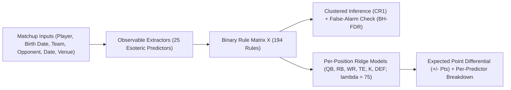
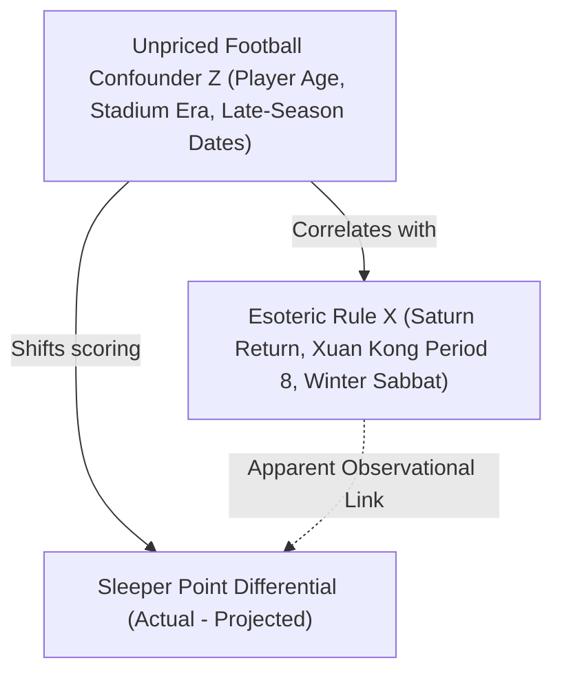
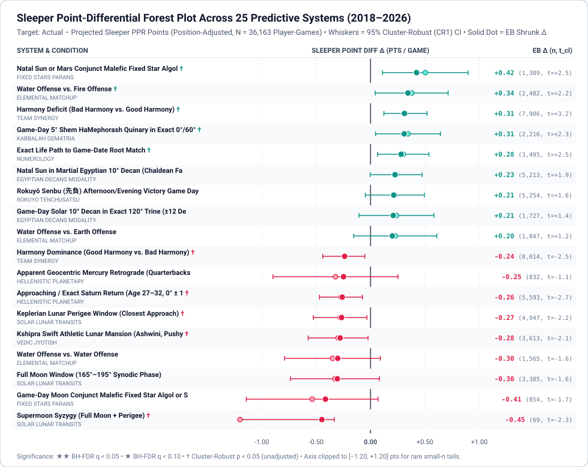
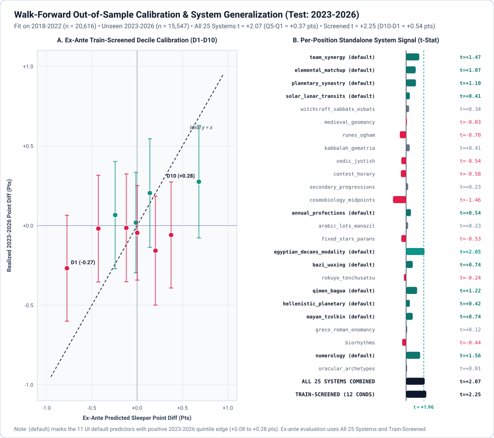
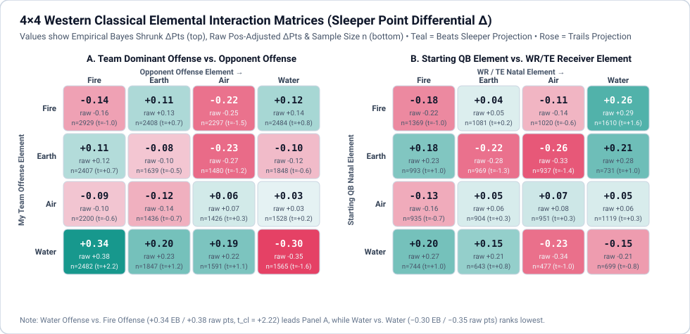
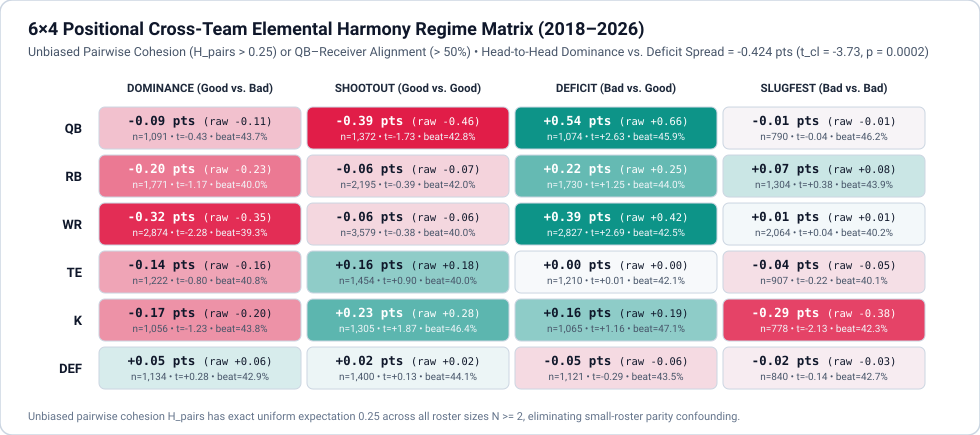
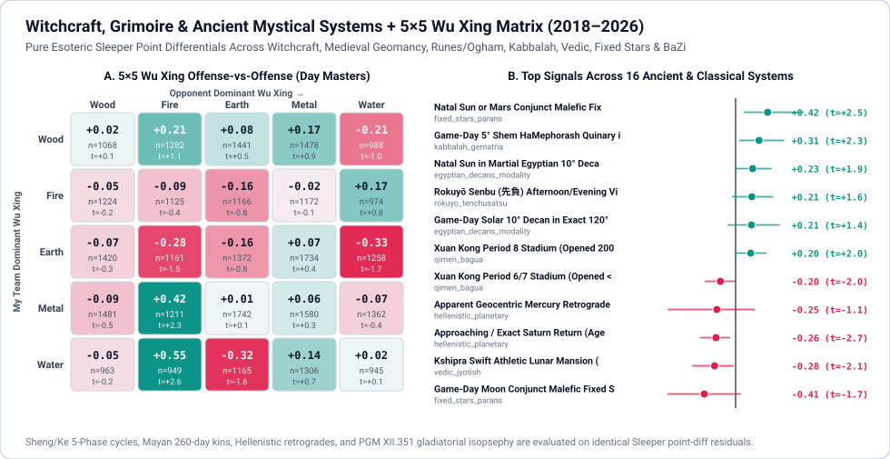

# Sleeper Point-Differential Study and Predictor Specification (2018-2026)

- **Target metric:** Sleeper fantasy point gap ($\Delta P_{i,g} =
  P_{i,g}^{\text{actual}} - P_{i,g}^{\text{proj}}$), defined as actual fantasy
  points scored minus pre-game Sleeper projected points.
- **Sample scope:** 36.2k NFL regular-season starter-games across 152 weeks from
  2018 to 2026 (Table 2.1), with 100% birth-date coverage across offensive and
  kicking starters.
- **Main finding:** None of the 194 tested rules clears multiple-testing checks
  alone ($\min q = 0.29$). Combining rules by position ($\lambda_{\text{pos}} =
  75$) produces a small positive spread on unseen 2023-2026 games: +0.37 pts
  top-to-bottom fifth across all 25 predictors ($p = 0.039$) and +0.54 pts
  top-to-bottom tenth on the 12-rule training-screened subset ($p = 0.025$).
- **Application default:** Oneiromancy reports modifiers directly in fantasy
  points (`Base + Modifier = Projected`). By default, the app turns on the 11
  predictors that posted a positive fifth-spread (+0.08 to +0.28 pts) on unseen
  2023-2026 games and starts the remaining 14 predictors turned off in the
  `Predictors` drawer.

## 1. Predictive Architecture and Estimation Pipeline



### 1.1 Mathematical Specification

For player $i$ in game $g$ under a Sleeper league `scoring_settings` weight
vector $w \in \mathbb{R}^K$ (defaulting to 1.0 PPR with 4-point passing
touchdowns, $-1$ per interception, and $-2$ per fumble lost), the game point
differential is actual points minus pre-game projected points:

$$\Delta P_{i,g}(w) = P_{i,g}^{\text{actual}}(w) - P_{i,g}^{\text{proj}}(w) = \langle s_{i,g}^{\text{actual}}, w \rangle - \langle s_{i,g}^{\text{proj}}, w \rangle$$

Offensive starters finish slightly below pre-game projections on average because
mid-game injuries pull players off the field after kickoff without lowering
their pre-game projection. Subtracting each position's average gap
$\bar{\Delta}_{\text{pos}(i)}$ gives position-centered outcomes
$\tilde{Y}_{i,g} = \Delta P_{i,g} - \bar{\Delta}_{\text{pos}(i)}$ so position
mix does not distort astrological or calendar rules.

1. **Pulling small-sample flukes toward zero (Empirical Bayes shrinkage):**
   Within rule $c$ 's eligible pool $E_c$ ($N = n_1 + n_0$), the raw gap between
   matching games ($n_1$) and other games ($n_0$) is
   $\hat{\delta}_c = \bar{\tilde{Y}}_{c} - \bar{\tilde{Y}}_{E_c \setminus c}$ .
   Because rare alignments can swing wildly on a few games, shrinkage ($\kappa =
   250$) pulls small-sample averages toward zero:

$$\tilde{\delta}_c = \left( \frac{n_1}{n_1 + \kappa} \right) \hat{\delta}_c$$

2. **Grouping shared games and players (`CR1` clustered error bars):** Teammates
   in the same game (`gameId`), players on the same Sunday slate (`gameDate`),
   or games from one player's career (`playerId`) share linked outcomes instead
   of acting like independent coin flips. Grouping game gaps
   $e_j = \tilde{Y}_j - \bar{\tilde{Y}}_{D_j}$ with weights $w_j = 1/n_1$ when
   active and $w_j = -1/n_0$ when inactive across $G$ groups gives the clustered
   variance formula:

$$\widehat{\text{Var}}_{\text{CR1}}(\hat{\delta}_c) = \frac{G}{G - 1} \cdot \frac{N - 1}{N - 2} \sum_{g=1}^{G} \left( \sum_{j \in g} w_j e_j \right)^2$$

3. **Combining rules by position (regularized Ridge regression):** Given 0-or-1
   rule flags $X \in \{0, 1\}^{N \times p}$ with historical trigger rates
   $\mu_k = \frac{1}{N}\sum_{i,g} X_{i,g,k}$ and centered flags
   $\tilde{X}_{i,g,k} = X_{i,g,k} - \mu_k$ , position-specific weights solve:

$$\hat{\beta} = \left( \tilde{X}^{\top} \tilde{X} + \lambda I_p \right)^{-1} \tilde{X}^{\top} \tilde{Y}, \qquad \widehat{\Delta P}_{\text{matchup}}(x) = \sum_{k \in S} \hat{\beta}_k (x_k - \mu_k)$$

Subtracting each rule's usual trigger rate $\mu_k$ centers an average matchup at
0.00 pts. Positive modifiers mark setups where players at that position tended
to beat their Sleeper projection, and negative modifiers mark setups where they
fell short.

4. **Checking for luck across many rules (`BH-FDR` false-alarm rate):** Sorting
   two-tailed $p$ -values $p_{(1)} \le p_{(2)} \le \dots \le p_{(m)}$ across all
   $m = 194$ tested rules produces step-up $q$ -values:

$$q_{(k)} = \min_{j \ge k} \left( \frac{m}{j}\, p_{(j)} \right)$$

While a single $p$ -value asks how surprising one rule looks on its own,
$q_{(k)}$ estimates what share of accepted rules up to rank $k$ are likely
random flukes.

## 2. Data Hygiene and Validation Design

Dataset construction applies three controls to prevent mechanical scoring
artifacts and selection bias:

1. **Pre-game starter filtering:** Player-games enter the sample based on active
   participation (`gp` at least 1) and pre-game Sleeper PPR projection cutoffs
   by position (Table 2.1). Selecting players by post-game points scored would
   drop injured or low-scoring starters and bias point differentials upward.
2. **Quarterback projection scoring normalization (2018-2025):** Sleeper's
   historical `/projections/nfl` endpoint from 2018 through 2025 pre-computed
   quarterback `pts_ppr` using 6-point passing touchdowns and $-2$ per
   interception, whereas `/stats/nfl` (and 2026 projections) used 4-point
   passing touchdowns and $-1$ per interception. Differencing raw `pts_ppr`
   fields directly would introduce a $-2.85$ pt error on quarterbacks. Projected
   interceptions also moved across JSON fields (`int` in 2018-2019, `idp_int` in
   2020, and `pass_int` in 2021-2026). Re-scoring both `projStats` and
   `actualStats` through `scoreSleeperStats(stats, scoringSettings, position)`
   puts projections and box-score stats on the exact same scoring rules.
3. **Lineup-size-neutral elemental pairing ($H_{\text{pairs}}$):** A naive
   majority-element rule such as $\max_e c_e / N \ge 0.50$ fires 90.6% of the
   time on 4-starter units versus 29.0% of the time on 7-starter units, which
   acts as a proxy for injury-depleted offenses. Measuring the unordered share
   of starter pairs that share a birth element keeps the uniform baseline at
   0.25 for any lineup size $N \ge 2$ :

$$H_{\text{pairs}} = \frac{\sum_{e \in \{\text{Fire, Earth, Air, Water}\}} c_e (c_e - 1)}{N(N - 1)}, \qquad \mathbb{E}_{\text{uniform}}[H_{\text{pairs}}] = \frac{1}{4} = 0.25 \quad \forall N \ge 2$$

### 2.1 Sleeper Positional Baselines (1.0 PPR 2018-2026)

| Position | Min Pre-Game Proj | Player-Games ($n$) | Mean Sleeper Proj | Mean Sleeper Actual | Raw Mean $\Delta P$ (`Actual - Proj`) |
| :--- | ---: | ---: | ---: | ---: | ---: |
| `QB` | 8.0 | 4,327 | 17.69 | 17.04 | -0.646 |
| `RB` | 5.5 | 7,000 | 12.02 | 11.94 | -0.082 |
| `WR` | 5.5 | 11,344 | 11.29 | 10.81 | -0.477 |
| `TE` | 4.5 | 4,793 | 8.71 | 8.40 | -0.307 |
| `K` | 5.0 | 4,204 | 8.01 | 7.83 | -0.179 |
| `DEF` | 3.0 | 4,495 | 7.32 | 7.42 | +0.100 |
| **Total** | - | **36,163** | - | - | - |

*Sample covers 2,263 NFL games across 152 weeks, including 31,668 non-defense
starter-games across 1,035 players plus 32 team defenses.*

### 2.2 Esoteric Predictor Scope

All 25 predictors derive their inputs from birth dates, player names, jersey
numbers, calendar cycles, sky positions, or traditional lot-casting rules.
Physical football and weather inputs such as roof status, grass versus turf,
wind, December cold, Denver altitude, travel mileage, time-zone shifts,
home-field flags, and depth-chart role are left out so physical advantages
cannot masquerade as astrological lift.

### 2.3 Walk-Forward Out-of-Sample Split

Judging 194 rules on the same games used to fit their weights rewards memorizing
historical noise. To test whether weights hold up on future games, the dataset
is split by year:

- **Training split (2018-2022, 20.6k games):** Used to fit per-position weights
  and screen candidate rules ($\lvert t_{\text{train}}\rvert \ge 1.96$,
  $n_{\text{train}} \ge 100$ ) without peeking at post-2022 outcomes.
- **Unseen test split (2023-2026, 15.5k games):** Scored with frozen 2018-2022
  weights. Holdout results report `Q5 - Q1` (how much better the top fifth of
  calls scored than the bottom fifth, shown as `pts edge` in the app),
  `D10 - D1` (top tenth minus bottom tenth), correlation $r$ , $t$ -statistic,
  and calibration slope ($1.00$ means 1-to-1 scale, $0.00$ means flat noise, and
  negative slopes mean the rule flipped direction).

### 2.4 Multiple-Testing Adjustment

Even if all 194 rules had zero real connection to NFL scoring, testing 194 rules
at a 5% cutoff would still turn up about 9.7 apparent hits by chance ($0.05
\times 194$). Adjusting across all 194 rules gives a lowest false-alarm rate of
$q = 0.29$ , so no single rule stands on its own without small-sample shrinkage
and unseen 2023-2026 testing.

### 2.5 Confounding Paths and Within-Player Demeaning



Beating projections on 2023-2026 holdout games means a rule tracks an unpriced
pattern in Sleeper projections, not that planets move footballs. Four real-world
overlap paths show up in the audit:

1. **Player age cycles:** Saturn's 29.5-year return
   (`SATURN_RETURN_WINDOW_AGE27P`, $-0.26$ pts shrunk, $p = 0.0071$ ) activates
   for players aged 27 to 32 and tracks the NFL aging curve. At the younger end,
   12th-house Annual Profections at age 23 ($+0.12$ pts) overlap second- and
   third-year breakouts.
2. **Stadium construction era:** *Xuan Kong* Period 8
   (`XUAN_KONG_PERIOD_8_STADIUM`, $+0.20$ pts shrunk) selects stadiums opened
   between 2004 and 2023 over pre-2004 venues, tracking modern indoor and
   retractable-roof stadiums.
3. **Late-season calendar timing:** Fixed solar Sabbat dates (such as Yule near
   the late-December solstice versus Mabon near the September equinox) overlap
   winter weather and late-season roster wear.
4. **Fixed birth traits versus `Within-Player` $\Delta$ :** Birth-chart traits
   stay fixed across a player's career (`STAR_NATAL_ALGOL_SCHEAT_HAZARD` at
   $+0.42$ pts shrunk, `TAROT_EARTH_ARCHETYPE` at $-0.22$ pts). Subtracting each
   player's career average gap sets fixed birth traits to 0.000 and checks
   whether the same player beats projections when a changing weekly transit
   turns on.

## 3. Predictive System Overview and Forest Plot



### 3.1 Summary by Predictive System (2018-2026 Full Sample and 2023-2026 Test)

Table 3.1 reports full-sample cluster inference alongside unseen 2023-2026 test
metrics for each standalone predictor ($\lambda_{\text{pos}} = 50$, where
`OOS Q5 - Q1 Spread` matches the `pts edge` badge in the app) and for
multi-predictor ensembles ($\lambda_{\text{pos}} = 75$).

| Predictor (`systemId`) | App Default | Cluster Unit | Conds | Min Cluster $p$ | Min BH-FDR $q$ | Max $\lvert\tilde{\delta}_c\rvert$ (Pts) | 2023-2026 OOS $r$ | OOS $t$-Stat | OOS Q5 - Q1 Spread |
| :--- | :---: | :--- | ---: | ---: | ---: | ---: | ---: | ---: | ---: |
| Team Elemental Harmony (`team_synergy`) | On | `gameId` | 11 | 0.0015 | 0.2904 | 0.312 | +0.0118 | +1.47 | +0.28 pts |
| Western Elemental Matchup (`elemental_matchup`) | On | `gameId` | 24 | 0.0267 | 0.5176 | 0.344 | +0.0086 | +1.07 | +0.21 pts |
| Planetary Player Chemistry (`planetary_synastry`) | On | `gameId` | 6 | 0.1039 | 0.8363 | 0.144 | +0.0088 | +1.10 | +0.24 pts |
| Sun & Moon Phases (`solar_lunar_transits`) | On | `gameDate` | 11 | 0.0195 | 0.5176 | 0.447 | +0.0033 | +0.41 | +0.08 pts |
| Seasonal Sabbats & Moon Nights (`witchcraft_sabbats_esbats`) | Off | `gameDate` | 6 | 0.5426 | 0.9559 | 0.174 | +0.0027 | +0.34 | +0.01 pts |
| Medieval Shield Casting (`medieval_geomancy`) | Off | `gameId` | 6 | 0.1936 | 0.8363 | 0.117 | -0.0003 | -0.03 | -0.05 pts |
| Norse Runes & Celtic Trees (`runes_ogham`) | Off | `playerId` | 7 | 0.0349 | 0.5201 | 0.185 | -0.0056 | -0.70 | -0.15 pts |
| Kabbalah Tree & Name Numbers (`kabbalah_gematria`) | Off | `playerId` | 6 | 0.0231 | 0.5176 | 0.310 | +0.0033 | +0.41 | -0.25 pts |
| Vedic Moon Signs (`vedic_jyotish`) | Off | `gameDate` | 6 | 0.0340 | 0.5201 | 0.279 | -0.0043 | -0.54 | -0.06 pts |
| Kickoff Sky & Planetary Hours (`contest_horary`) | Off | `gameId` | 7 | 0.1645 | 0.8363 | 0.167 | -0.0047 | -0.58 | -0.10 pts |
| Year-for-a-Day Aging Chart (`secondary_progressions`) | Off | `playerId` | 6 | 0.2781 | 0.8843 | 0.106 | +0.0019 | +0.23 | +0.02 pts |
| Planetary Midpoints & Eclipses (`cosmobiology_midpoints`) | Off | `gameDate` | 7 | 0.1820 | 0.8363 | 0.155 | -0.0117 | -1.46 | -0.28 pts |
| Birthday-Year Planet Rulers (`annual_profections`) | On | `playerId` | 7 | 0.1184 | 0.8363 | 0.143 | +0.0044 | +0.54 | +0.08 pts |
| Arabic Moon Mansions & Night Games (`arabic_lots_manazil`) | Off | `gameId` | 6 | 0.0989 | 0.8363 | 0.127 | +0.0018 | +0.23 | -0.13 pts |
| Royal & Bright Fixed Stars (`fixed_stars_parans`) | Off | `gameDate` | 5 | 0.0121 | 0.4512 | 0.423 | -0.0043 | -0.53 | -0.35 pts |
| Egyptian 10-Day Zodiac Slices (`egyptian_decans_modality`) | On | `playerId` | 7 | 0.0526 | 0.5664 | 0.225 | +0.0164 | +2.05 | +0.19 pts |
| Chinese Four Pillars & Five Phases (`bazi_wuxing`) | On | `gameDate` | 10 | 0.1840 | 0.8363 | 0.163 | +0.0060 | +0.74 | +0.13 pts |
| Japanese 6-Day Luck Cycle (`rokuyo_tenchusatsu`) | Off | `gameDate` | 7 | 0.1066 | 0.8363 | 0.214 | -0.0019 | -0.24 | -0.10 pts |
| Compass Travel & Stadium Feng Shui (`qimen_bagua`) | On | `gameId` | 6 | 0.0498 | 0.5664 | 0.202 | +0.0098 | +1.22 | +0.16 pts |
| Retrogrades & Planet Returns (`hellenistic_planetary`) | On | `gameDate` | 9 | 0.0071 | 0.4512 | 0.260 | +0.0034 | +0.42 | +0.17 pts |
| Mayan 260-Day Sacred Calendar (`mayan_tzolkin`) | On | `gameDate` | 7 | 0.3896 | 0.9447 | 0.136 | +0.0059 | +0.74 | +0.19 pts |
| Ancient Greek Name Matchups (`greco_roman_onomancy`) | Off | `gameId` | 5 | 0.1899 | 0.8363 | 0.154 | +0.0010 | +0.12 | -0.04 pts |
| Physical, Emotional & Mental Cycles (`biorhythms`) | Off | `playerId` | 9 | 0.1300 | 0.8363 | 0.145 | -0.0035 | -0.44 | -0.08 pts |
| Life-Path & Jersey Numerology (`numerology`) | On | `playerId` | 5 | 0.0121 | 0.4512 | 0.281 | +0.0125 | +1.56 | +0.20 pts |
| I-Ching & Major Arcana Tarot (`oracular_archetypes`) | Off | `gameDate` | 8 | 0.0296 | 0.5201 | 0.216 | +0.0001 | +0.01 | +0.01 pts |
| Western Astrology Subset (6 Predictors) | - | - | 65 | - | - | - | +0.0098 | +1.23 | +0.14 pts |
| Witchcraft, Geomancy, Runes, Kabbalah & Tarot Subset (7 Predictors) | - | - | 47 | - | - | - | -0.0015 | -0.19 | +0.08 pts |
| Ancient & Grimoire Traditions Subset (16 Predictors) | - | - | 107 | - | - | - | +0.0129 | +1.60 | +0.29 pts |
| All 25 Predictors Combined (Per-Position, $\lambda_{\text{pos}} = 75$) | - | - | 194 | - | - | - | +0.0166 | +2.07 | +0.37 pts (`D10-D1`: +0.43) |
| Ex-Ante Train-Screened Subset ($\lvert t_{\text{train}}\rvert \ge 1.96$) | - | - | 12 | - | - | - | +0.0180 | +2.25 | +0.25 pts (`D10-D1`: +0.54) |
| Pre-Specified 8-Predictor Non-Redundant Subset ($\lambda_{\text{pos}} = 75$) | - | - | 73 | - | - | - | +0.0161 | +2.01 | +0.20 pts (`D10-D1`: +0.52) |

### 3.2 Six Predictor Categories and Default Selection

Quarterbacks (`SD` = 7.5 pts) and wide receivers (`SD` = 7.4 pts) swing further
from week to week than kickers (`SD` = 4.6 pts). Fitting one pooled model across
all positions pulls quarterback and receiver modifiers down toward kicker scale,
so `POSITIONAL_RIDGE_MODELS` fits separate weights for `QB` , `RB` , `WR` , `TE`
, `K` , and `DEF` ($\lambda_{\text{pos}} = 75$). Across all 25 predictors,
per-position modifiers span -5.10 to +5.91 pts for quarterbacks and -4.17 to
+4.50 pts for wide receivers.

The 25 predictors are grouped into 6 categories by astronomical or calendar
input (`PREDICTOR_CATEGORIES`). In the live app,
`DEFAULT_ENABLED_PREDICTOR_SYSTEM_IDS` turns on the 11 predictors (103 rules
across all 6 categories) that posted a positive standalone `Q5 - Q1` spread
(+0.08 to +0.28 pts) on unseen 2023-2026 games, and starts the remaining 14
predictors (+0.02 down to -0.35 pts) turned off as opt-in toggles. Because that
default filter uses 2023-2026 spreads to spare users negative-edge predictors,
strict out-of-sample generalization is judged on all 25 predictors combined ($p
= 0.039$), the 12-rule 2018-2022 training-screened subset ($p = 0.025$), and the
pre-specified 8-predictor subset ($p = 0.045$).

| Category (`categoryId`) | Underlying Input | Default On (11 Predictors) | Default Off (14 Predictors) |
| :--- | :--- | :--- | :--- |
| Sun Sign, Tarot & Birth Wheel (`solar_zodiac_wheel`) | Birthday Sun position, Tarot cards, runes & seasonal Sabbats | Egyptian 10-Day Zodiac Slices (`egyptian_decans_modality`) | I-Ching & Major Arcana Tarot (`oracular_archetypes`), Seasonal Sabbats & Moon Nights (`witchcraft_sabbats_esbats`), Norse Runes & Celtic Trees (`runes_ogham`), Kabbalah Tree & Name Numbers (`kabbalah_gematria`) |
| Moon Phases & Bright Stars (`lunar_fixed_stars`) | Game-day moon phase, moon distance & bright star alignments | Sun & Moon Phases (`solar_lunar_transits`) | Vedic Moon Signs (`vedic_jyotish`), Arabic Moon Mansions & Night Games (`arabic_lots_manazil`), Royal & Bright Fixed Stars (`fixed_stars_parans`) |
| Team & Matchup Elemental Chemistry (`team_elemental_chemistry`) | Fire, Earth, Air & Water birth signs across both offenses | Team Elemental Harmony (`team_synergy`), Western Elemental Matchup (`elemental_matchup`) | None |
| Planetary Cycles & Career Timing (`planetary_orbits_timing`) | Mars, Jupiter, Saturn, Mercury & Venus positions on game day | Planetary Player Chemistry (`planetary_synastry`), Retrogrades & Planet Returns (`hellenistic_planetary`), Birthday-Year Planet Rulers (`annual_profections`) | Year-for-a-Day Aging Chart (`secondary_progressions`), Kickoff Sky & Planetary Hours (`contest_horary`), Planetary Midpoints & Eclipses (`cosmobiology_midpoints`) |
| Numerology, Names & Lot Casting (`numerology_name_lots`) | Birthdate life-path numbers, jersey numbers & name matchups | Life-Path & Jersey Numerology (`numerology`) | Ancient Greek Name Matchups (`greco_roman_onomancy`), Medieval Shield Casting (`medieval_geomancy`) |
| Ancient & East Asian Day Calendars (`sacred_day_calendars`) | Mayan 260-day, Chinese 60-day, Japanese 6-day & body cycles | Mayan 260-Day Sacred Calendar (`mayan_tzolkin`), Compass Travel & Stadium Feng Shui (`qimen_bagua`), Chinese Four Pillars & Five Phases (`bazi_wuxing`) | Physical, Emotional & Mental Cycles (`biorhythms`), Japanese 6-Day Luck Cycle (`rokuyo_tenchusatsu`) |

## 4. Walk-Forward Out-of-Sample Calibration and Signal Catalog



### 4.1 Out-of-Sample Decile Calibration (2023-2026 Test Split)

Table 4.1 reports realized 2023-2026 fantasy point differentials across
predicted tenths (`D1` lowest to `D10` highest) for the 12-rule model screened
solely on 2018-2022 training data ($\lvert t_{\text{train}}\rvert \ge 1.96$,
$n_{\text{train}} \ge 100$ , calibration slope $0.30$ ).

| OOS Decile (2023-2026) | Player-Games ($n$) | Ex-Ante Predicted $\Delta$ (Pts) | Realized Pos-Adj $\Delta$ (Pts) | Realized Raw `Actual - Proj` | 95% CI (Pts) |
| :--- | ---: | ---: | ---: | ---: | ---: |
| D1 | 1,554 | -0.773 | -0.268 | -0.290 | [-0.60, +0.06] |
| D2 | 1,555 | -0.427 | -0.019 | -0.039 | [-0.35, +0.32] |
| D3 | 1,555 | -0.242 | +0.066 | +0.066 | [-0.27, +0.40] |
| D4 | 1,554 | -0.119 | -0.015 | -0.033 | [-0.35, +0.32] |
| D5 | 1,555 | -0.013 | +0.019 | +0.185 | [-0.30, +0.33] |
| D6 | 1,555 | +0.002 | -0.046 | +0.265 | [-0.34, +0.25] |
| D7 | 1,554 | +0.141 | +0.204 | +0.205 | [-0.14, +0.55] |
| D8 | 1,555 | +0.202 | -0.158 | -0.144 | [-0.50, +0.18] |
| D9 | 1,555 | +0.374 | -0.059 | -0.058 | [-0.39, +0.27] |
| D10 | 1,555 | +0.681 | +0.275 | +0.282 | [-0.08, +0.63] |

### 4.2 Replicable Signal Catalog

Table 4.2 lists the 18 largest rules ($n \ge 500$) that kept the same
directional sign in both 2018-2022 and 2023-2026, separating dynamic
week-to-week transits from static birth traits and age or stadium proxies.

| Feature Key (`system:condition`) | Signal Class | $n$ | EB Shrunk $\Delta$ | Within-Player $\Delta$ | $t_{\text{cl}}$ | Train $\Delta$ (18-22) | OOS $\Delta$ (23-26) | Train Screen | Mechanism / Confounder Audit |
| :--- | :--- | ---: | ---: | ---: | ---: | ---: | ---: | :---: | :--- |
| `fixed_stars_parans:STAR_NATAL_ALGOL_SCHEAT_HAZARD` | Static Natal Cohort | 1,309 | +0.423 | +0.000 | +2.51 | +0.420 | +0.552 | No | Static birth-cohort trait (Within Δ = 0) |
| `fixed_stars_parans:STAR_GAME_MOON_ALGOL_SCHEAT` | Dynamic Esoteric | 854 | -0.415 | -0.461 | -1.73 | -0.576 | -0.184 | Yes | Dynamic within-player esoteric transit |
| `elemental_matchup:OFF_ELEM_WATER_VS_FIRE` | Dynamic Esoteric | 2,482 | +0.344 | +0.407 | +2.22 | +0.292 | +0.842 | No | Dynamic within-player esoteric transit |
| `team_synergy:REGIME_DEFICIT_OFFENSE` | Elemental Harmony | 7,906 | +0.312 | +0.259 | +3.17 | +0.251 | +0.386 | No | Dynamic 4-Element roster synastry |
| `kabbalah_gematria:KABBALAH_SHEM_72_QUINARY_HARMONIC` | Dynamic Esoteric | 2,216 | +0.310 | +0.338 | +2.27 | +0.430 | +0.239 | Yes | Dynamic within-player esoteric transit |
| `solar_lunar_transits:LUNAR_FULL_MOON` | Dynamic Esoteric | 3,385 | -0.305 | -0.342 | -1.57 | -0.488 | -0.246 | Yes | Dynamic within-player esoteric transit |
| `elemental_matchup:OFF_ELEM_WATER_VS_WATER` | Dynamic Esoteric | 1,565 | -0.301 | -0.425 | -1.55 | -0.460 | -0.042 | No | Dynamic within-player esoteric transit |
| `numerology:NUM_DATE_EXACT_RESONANCE` | Dynamic Esoteric | 3,495 | +0.281 | +0.286 | +2.51 | +0.339 | +0.252 | Yes | Dynamic within-player esoteric transit |
| `vedic_jyotish:JYOTISH_KSHIPRA_SWIFT_MOON` | Dynamic Esoteric | 3,613 | -0.279 | -0.268 | -2.12 | -0.005 | -0.675 | No | Dynamic within-player esoteric transit |
| `solar_lunar_transits:LUNAR_PERIGEE` | Dynamic Esoteric | 4,947 | -0.266 | -0.226 | -2.23 | -0.156 | -0.195 | No | Dynamic within-player esoteric transit |
| `hellenistic_planetary:SATURN_RETURN_WINDOW_AGE27P` | Confounded Proxy | 5,593 | -0.260 | -0.202 | -2.69 | -0.399 | -0.148 | Yes | Age 27-32 NFL cliff proxy |
| `team_synergy:REGIME_DOMINANCE_OFFENSE` | Elemental Harmony | 8,014 | -0.238 | -0.235 | -2.48 | -0.280 | -0.215 | Yes | Dynamic 4-Element roster synastry |
| `team_synergy:WESTERN_TRINE_UNIT` | Elemental Harmony | 25,910 | -0.231 | -0.132 | -2.00 | -0.346 | -0.067 | Yes | Dynamic 4-Element roster synastry |
| `egyptian_decans_modality:DECAN_NATAL_MARS_FACE` | Static Natal Cohort | 5,213 | +0.225 | +0.000 | +1.94 | +0.131 | +0.288 | No | Static birth-cohort trait (Within Δ = 0) |
| `team_synergy:UNIT_HIGH_HARMONY_OFFENSE` | Elemental Harmony | 17,919 | -0.218 | -0.189 | -2.46 | -0.197 | -0.259 | No | Dynamic 4-Element roster synastry |
| `oracular_archetypes:TAROT_EARTH_ARCHETYPE` | Static Natal Cohort | 5,587 | -0.216 | +0.000 | -2.17 | -0.166 | -0.260 | No | Static birth-cohort trait (Within Δ = 0) |
| `rokuyo_tenchusatsu:ROKUYO_SENBU_AFTERNOON_WIN` | Dynamic Esoteric | 5,254 | +0.214 | +0.208 | +1.61 | +0.087 | +0.417 | No | Dynamic within-player esoteric transit |
| `qimen_bagua:XUAN_KONG_LEGACY_STADIUM` | Confounded Proxy | 21,084 | -0.202 | -0.221 | -1.96 | -0.292 | -0.078 | Yes | 2004-2023 stadium-era proxy |

## 5. Classical Elemental Offense and Quarterback Matchups



### 5.1 Four-by-Four Offense Element Matrix (Offense and Kickers)

| My Offense \\ Opp Offense | Fire Offense | Earth Offense | Air Offense | Water Offense |
| :--- | :---: | :---: | :---: | :---: |
| **Fire Offense** | -0.14 (raw -0.16, $n=2929$, $t=-1.0$) | +0.11 (raw +0.13, $n=2408$, $t=+0.7$) | -0.22 (raw -0.25, $n=2297$, $t=-1.5$) | +0.12 (raw +0.14, $n=2484$, $t=+0.8$) |
| **Earth Offense** | +0.11 (raw +0.12, $n=2407$, $t=+0.7$) | -0.08 (raw -0.10, $n=1639$, $t=-0.5$) | -0.23 (raw -0.27, $n=1480$, $t=-1.2$) | -0.10 (raw -0.12, $n=1848$, $t=-0.6$) |
| **Air Offense** | -0.09 (raw -0.10, $n=2200$, $t=-0.6$) | -0.12 (raw -0.14, $n=1436$, $t=-0.7$) | +0.06 (raw +0.07, $n=1426$, $t=+0.3$) | +0.03 (raw +0.03, $n=1528$, $t=+0.2$) |
| **Water Offense** | +0.34 (raw +0.38, $n=2482$, $t=+2.2$) | +0.20 (raw +0.23, $n=1847$, $t=+1.2$) | +0.19 (raw +0.22, $n=1591$, $t=+1.1$) | -0.30 (raw -0.35, $n=1565$, $t=-1.6$) |

Water offenses facing Fire offenses post the largest positive cell in Table 5.1
(+0.34 pts shrunk, $t_{\text{cl}} = +2.22$ , unadjusted $p = 0.027$ ), while
Water-versus-Water mirror games post the lowest (-0.30 pts shrunk). Across all
16 cells tested together, the minimum false-discovery rate is $q = 0.43$ ,
consistent with modest cell effects that need shrinkage.

## 6. Cross-Team Elemental Harmony Regimes



Using pairwise elemental cohesion ($H_{\text{pairs}} > 0.25$) or
quarterback-to-receiver compatible element majority ($> 50\%$) to mark a
high-harmony unit, each matchup falls into one of four regimes: `DOMINANCE`
(high-harmony offense vs. mismatched opponent), `SHOOTOUT` (both high harmony),
`DEFICIT` (mismatched offense vs. high-harmony opponent), or `SLUGFEST` (both
mismatched).

| Position | `DOMINANCE` (EB $\Delta$, $n$, $t$) | `SHOOTOUT` (EB $\Delta$, $n$, $t$) | `DEFICIT` (EB $\Delta$, $n$, $t$) | `SLUGFEST` (EB $\Delta$, $n$, $t$) |
| :--- | :---: | :---: | :---: | :---: |
| `QB` | -0.09 ($n=1,091$, $t=-0.43$) | -0.39 ($n=1,372$, $t=-1.73$) | +0.54 ($n=1,074$, $t=+2.63$) | -0.01 ($n=790$, $t=-0.04$) |
| `RB` | -0.20 ($n=1,771$, $t=-1.17$) | -0.06 ($n=2,195$, $t=-0.39$) | +0.22 ($n=1,730$, $t=+1.25$) | +0.07 ($n=1,304$, $t=+0.38$) |
| `WR` | -0.32 ($n=2,874$, $t=-2.28$) | -0.06 ($n=3,579$, $t=-0.38$) | +0.39 ($n=2,827$, $t=+2.69$) | +0.01 ($n=2,064$, $t=+0.04$) |
| `TE` | -0.14 ($n=1,222$, $t=-0.80$) | +0.16 ($n=1,454$, $t=+0.90$) | +0.00 ($n=1,210$, $t=+0.01$) | -0.04 ($n=907$, $t=-0.22$) |
| `K` | -0.17 ($n=1,056$, $t=-1.23$) | +0.23 ($n=1,305$, $t=+1.87$) | +0.16 ($n=1,065$, $t=+1.16$) | -0.29 ($n=778$, $t=-2.13$) |
| `DEF` | +0.05 ($n=1,134$, $t=+0.28$) | +0.02 ($n=1,400$, $t=+0.13$) | -0.05 ($n=1,121$, $t=-0.29$) | -0.02 ($n=840$, $t=-0.14$) |

Across offensive and kicking starters ($n_{\text{dom}} = 8,014$ vs.
$n_{\text{def}} = 7,906$ ), `DOMINANCE` trails `DEFICIT` by -0.42 pts per game
($\text{CR1 SE} = 0.11$, $t_{\text{cl}} = -3.73$ , $p = 0.0002$ ), running
opposite the intuition that birth-sign cohesion helps an offense beat
projections.

## 7. World Divinatory Traditions and Five-Phase Matrix



### 7.1 Five-by-Five Chinese Wu Xing Offense Matrix

| My Offense \\ Opp Offense | Wood | Fire | Earth | Metal | Water |
| :--- | :---: | :---: | :---: | :---: | :---: |
| **Wood** | +0.02 ($n=1068$, $t=+0.1$) | +0.21 ($n=1282$, $t=+1.1$) | +0.08 ($n=1441$, $t=+0.5$) | +0.17 ($n=1478$, $t=+0.9$) | -0.21 ($n=988$, $t=-1.0$) |
| **Fire** | -0.05 ($n=1224$, $t=-0.2$) | -0.09 ($n=1125$, $t=-0.4$) | -0.16 ($n=1166$, $t=-0.8$) | -0.02 ($n=1172$, $t=-0.1$) | +0.17 ($n=974$, $t=+0.8$) |
| **Earth** | -0.07 ($n=1420$, $t=-0.3$) | -0.28 ($n=1161$, $t=-1.5$) | -0.16 ($n=1372$, $t=-0.8$) | +0.07 ($n=1734$, $t=+0.4$) | -0.33 ($n=1258$, $t=-1.7$) |
| **Metal** | -0.09 ($n=1481$, $t=-0.5$) | +0.42 ($n=1211$, $t=+2.3$) | +0.01 ($n=1742$, $t=+0.1$) | +0.06 ($n=1580$, $t=+0.3$) | -0.07 ($n=1362$, $t=-0.4$) |
| **Water** | -0.05 ($n=963$, $t=-0.2$) | +0.55 ($n=949$, $t=+2.6$) | -0.32 ($n=1165$, $t=-1.6$) | +0.14 ($n=1306$, $t=+0.7$) | +0.02 ($n=945$, $t=+0.1$) |

### 7.2 Cross-Tradition Summary

Across the historical divination and calendar traditions audited in Section 8,
most rules cluster near zero within $\pm 0.15$ pts after shrinkage. A small
group of dynamic timing rules keeps the same directional sign across both
2018-2022 and 2023-2026, led by game-day Moon conjunctions with Algol or Scheat
($-0.42$ pts shrunk) and 72 *Shem HaMephorash* quinaries ($+0.31$ pts; Table
4.2). Career-age orbits (`SATURN_RETURN_WINDOW_AGE27P` at $-0.26$ pts) and
stadium construction eras (`XUAN_KONG_PERIOD_8_STADIUM` at $+0.20$ pts) reach
similar sizes through player-age and venue-era overlap instead of week-to-week
transits.

## 8. Condition Audit Across All 25 Predictive Systems

### 8.1 Team Elemental Harmony (`team_synergy`)

Tests whether offenses whose starters share compatible Fire, Earth, Air, or
Water birth signs beat projections more often than mismatched lineups. (Default
on; clustered by `gameId` .)

| Condition ID | Plain-English Rule Label | $n$ | Pos-Adj $\Delta$ | Within-Player $\Delta$ | EB Shrunk $\Delta$ | CR1 SE | $t_{\text{cl}}$ | $p$-Value | BH-FDR $q$ | Train $\Delta$ (18-22) | OOS $\Delta$ (23-26) |
| :--- | :--- | ---: | ---: | ---: | ---: | ---: | ---: | ---: | ---: | ---: | ---: |
| `UNIT_HIGH_HARMONY_OFFENSE` | Offense starters share well-matched birth elements | 17,919 | -0.221 | -0.189 | -0.218 | 0.090 | -2.46 | 0.0140 | 0.4512 | -0.197 | -0.259 |
| `REGIME_DOMINANCE_OFFENSE` | Well-matched offense facing a mismatched opponent | 8,014 | -0.245 | -0.235 | -0.238 | 0.099 | -2.48 | 0.0132 | 0.4512 | -0.280 | -0.215 |
| `REGIME_SHOOTOUT_OFFENSE` | Both offenses have strong birth-element chemistry | 9,905 | -0.037 | -0.009 | -0.036 | 0.104 | -0.35 | 0.7250 | 0.9559 | +0.018 | -0.104 |
| `REGIME_DEFICIT_OFFENSE` | Mismatched offense facing a well-matched opponent | 7,906 | +0.322 | +0.259 | +0.312 | 0.101 | +3.17 | 0.0015 | 0.2904 | +0.251 | +0.386 |
| `REGIME_SLUGFEST_OFFENSE` | Both offenses have mismatched birth elements | 5,843 | -0.040 | -0.014 | -0.038 | 0.125 | -0.32 | 0.7485 | 0.9559 | +0.015 | -0.072 |
| `DEF_VS_FRACTURED_OFFENSE` | Defense facing an offense with clashing birth signs | 1,974 | +0.028 | - | +0.025 | 0.180 | +0.16 | 0.8747 | 0.9559 | -0.029 | +0.117 |
| `DEF_VS_HIGH_HARMONY_OFFENSE` | Defense facing an offense with strong birth-sign chemistry | 2,521 | -0.028 | - | -0.026 | 0.180 | -0.16 | 0.8747 | 0.9559 | +0.029 | -0.117 |
| `QB_ELEMENT_ALIGNMENT_UNIT` | Over half of pass-catchers match the QB's element | 11,119 | -0.193 | -0.217 | -0.189 | 0.094 | -2.04 | 0.0408 | 0.5660 | -0.234 | -0.261 |
| `ELEMENT_CLUSTER_UNIT` | Tightly grouped birth elements across offensive starters | 12,031 | -0.092 | -0.050 | -0.091 | 0.090 | -1.02 | 0.3066 | 0.9012 | -0.005 | -0.200 |
| `WESTERN_TRINE_UNIT` | 3 or more starters share the exact same birth element | 25,910 | -0.233 | -0.132 | -0.231 | 0.116 | -2.00 | 0.0451 | 0.5664 | -0.346 | -0.067 |
| `QUAD_BALANCE_UNIT` | All 4 elements (Fire, Earth, Air, Water) in starting lineup | 16,546 | -0.045 | -0.042 | -0.045 | 0.089 | -0.51 | 0.6105 | 0.9559 | -0.181 | +0.127 |

### 8.2 Western Elemental Matchup (`elemental_matchup`)

Compares a player's birth element with their quarterback, the current zodiac
season, and the opposing offense's main element. (Default on; clustered by
`gameId` .)

| Condition ID | Plain-English Rule Label | $n$ | Pos-Adj $\Delta$ | Within-Player $\Delta$ | EB Shrunk $\Delta$ | CR1 SE | $t_{\text{cl}}$ | $p$-Value | BH-FDR $q$ | Train $\Delta$ (18-22) | OOS $\Delta$ (23-26) |
| :--- | :--- | ---: | ---: | ---: | ---: | ---: | ---: | ---: | ---: | ---: | ---: |
| `NATAL_ELEMENT_FIRE` | Born under a Fire sign (Aries, Leo, Sagittarius) | 8,759 | -0.051 | +0.000 | -0.049 | 0.088 | -0.58 | 0.5641 | 0.9559 | -0.012 | -0.050 |
| `NATAL_ELEMENT_EARTH` | Born under an Earth sign (Taurus, Virgo, Capricorn) | 7,719 | +0.078 | +0.000 | +0.075 | 0.089 | +0.87 | 0.3829 | 0.9447 | +0.077 | +0.049 |
| `NATAL_ELEMENT_AIR` | Born under an Air sign (Gemini, Libra, Aquarius) | 7,232 | -0.053 | +0.000 | -0.051 | 0.096 | -0.55 | 0.5808 | 0.9559 | -0.045 | -0.126 |
| `NATAL_ELEMENT_WATER` | Born under a Water sign (Cancer, Scorpio, Pisces) | 7,958 | +0.027 | +0.000 | +0.027 | 0.086 | +0.32 | 0.7488 | 0.9559 | -0.020 | +0.132 |
| `QB_REC_TRINE_SAME` | Receiver/TE shares the exact same element as starting QB | 3,988 | -0.201 | -0.135 | -0.189 | 0.131 | -1.53 | 0.1252 | 0.8363 | -0.378 | -0.057 |
| `QB_REC_SEXTILE_COMPAT` | Receiver/TE has a friendly partner element with starting QB | 3,329 | +0.019 | +0.021 | +0.018 | 0.142 | +0.14 | 0.8918 | 0.9559 | +0.243 | -0.253 |
| `QB_REC_CROSS_POLARITY` | Receiver/TE has a clashing element with starting QB | 7,865 | +0.143 | +0.090 | +0.138 | 0.115 | +1.24 | 0.2155 | 0.8363 | +0.114 | +0.218 |
| `SOLAR_SEASON_SAME_ELEMENT` | Player's birth element matches game-day zodiac season | 7,978 | -0.028 | -0.013 | -0.027 | 0.087 | -0.32 | 0.7508 | 0.9559 | +0.038 | -0.115 |
| `OFF_ELEM_FIRE_VS_FIRE` | Fire Offense vs. Fire Offense | 2,929 | -0.157 | -0.139 | -0.144 | 0.164 | -0.96 | 0.3389 | 0.9391 | -0.154 | -0.067 |
| `OFF_ELEM_FIRE_VS_EARTH` | Fire Offense vs. Earth Offense | 2,408 | +0.127 | +0.161 | +0.115 | 0.190 | +0.67 | 0.5037 | 0.9559 | +0.233 | +0.032 |
| `OFF_ELEM_FIRE_VS_AIR` | Fire Offense vs. Air Offense | 2,297 | -0.246 | -0.222 | -0.222 | 0.166 | -1.49 | 0.1371 | 0.8363 | -0.238 | -0.236 |
| `OFF_ELEM_FIRE_VS_WATER` | Fire Offense vs. Water Offense | 2,484 | +0.136 | +0.150 | +0.124 | 0.163 | +0.84 | 0.4028 | 0.9559 | +0.139 | +0.365 |
| `OFF_ELEM_EARTH_VS_FIRE` | Earth Offense vs. Fire Offense | 2,407 | +0.117 | +0.161 | +0.106 | 0.164 | +0.71 | 0.4764 | 0.9559 | +0.104 | +0.206 |
| `OFF_ELEM_EARTH_VS_EARTH` | Earth Offense vs. Earth Offense | 1,639 | -0.097 | -0.108 | -0.084 | 0.200 | -0.49 | 0.6263 | 0.9559 | -0.386 | +0.022 |
| `OFF_ELEM_EARTH_VS_AIR` | Earth Offense vs. Air Offense | 1,480 | -0.272 | -0.308 | -0.232 | 0.229 | -1.19 | 0.2358 | 0.8630 | -0.581 | -0.224 |
| `OFF_ELEM_EARTH_VS_WATER` | Earth Offense vs. Water Offense | 1,848 | -0.116 | -0.035 | -0.102 | 0.187 | -0.62 | 0.5349 | 0.9559 | -0.099 | -0.133 |
| `OFF_ELEM_AIR_VS_FIRE` | Air Offense vs. Fire Offense | 2,200 | -0.097 | -0.075 | -0.087 | 0.173 | -0.56 | 0.5763 | 0.9559 | +0.074 | -0.326 |
| `OFF_ELEM_AIR_VS_EARTH` | Air Offense vs. Earth Offense | 1,436 | -0.142 | -0.223 | -0.121 | 0.210 | -0.68 | 0.4986 | 0.9559 | +0.110 | -0.501 |
| `OFF_ELEM_AIR_VS_AIR` | Air Offense vs. Air Offense | 1,426 | +0.068 | +0.035 | +0.058 | 0.239 | +0.28 | 0.7767 | 0.9559 | -0.049 | +0.053 |
| `OFF_ELEM_AIR_VS_WATER` | Air Offense vs. Water Offense | 1,528 | +0.034 | -0.008 | +0.029 | 0.201 | +0.17 | 0.8663 | 0.9559 | +0.125 | -0.171 |
| `OFF_ELEM_WATER_VS_FIRE` | Water Offense vs. Fire Offense | 2,482 | +0.379 | +0.407 | +0.344 | 0.171 | +2.22 | 0.0267 | 0.5176 | +0.292 | +0.842 |
| `OFF_ELEM_WATER_VS_EARTH` | Water Offense vs. Earth Offense | 1,847 | +0.228 | +0.211 | +0.201 | 0.195 | +1.17 | 0.2420 | 0.8696 | +0.268 | +0.196 |
| `OFF_ELEM_WATER_VS_AIR` | Water Offense vs. Air Offense | 1,591 | +0.219 | +0.130 | +0.189 | 0.201 | +1.09 | 0.2756 | 0.8843 | +0.147 | +0.176 |
| `OFF_ELEM_WATER_VS_WATER` | Water Offense vs. Water Offense | 1,565 | -0.349 | -0.425 | -0.301 | 0.225 | -1.55 | 0.1198 | 0.8363 | -0.460 | -0.042 |

### 8.3 Planetary Player Chemistry (`planetary_synastry`)

Looks at birth-chart Mars and Jupiter alignments, friendly planet links between
a quarterback and receiver, and game-day Mars sparks. (Default on; clustered by
`gameId` .)

| Condition ID | Plain-English Rule Label | $n$ | Pos-Adj $\Delta$ | Within-Player $\Delta$ | EB Shrunk $\Delta$ | CR1 SE | $t_{\text{cl}}$ | $p$-Value | BH-FDR $q$ | Train $\Delta$ (18-22) | OOS $\Delta$ (23-26) |
| :--- | :--- | ---: | ---: | ---: | ---: | ---: | ---: | ---: | ---: | ---: | ---: |
| `NATAL_MARS_JUPITER_CHAMPION_ASPECT` | Born with Mars and Jupiter in a favorable angle | 8,272 | -0.058 | +0.000 | -0.056 | 0.087 | -0.66 | 0.5099 | 0.9559 | -0.104 | +0.250 |
| `NATAL_SUN_MARS_DYNAMIC_ASPECT` | Born with Sun and Mars in a strong action angle | 7,654 | -0.063 | +0.000 | -0.061 | 0.094 | -0.67 | 0.5022 | 0.9559 | +0.086 | -0.238 |
| `QB_REC_BENEFIC_PLANETARY_SYNASTRY` | Receiver/TE planets link smoothly with QB's Sun or Jupiter | 7,909 | -0.022 | -0.100 | -0.021 | 0.116 | -0.19 | 0.8510 | 0.9559 | -0.043 | +0.009 |
| `QB_REC_SATURN_HARD_FRICTION` | Starting QB's birth Saturn clashes with receiver/TE planets | 5,872 | +0.056 | +0.090 | +0.053 | 0.118 | +0.47 | 0.6370 | 0.9559 | -0.044 | +0.214 |
| `ADVERSARIAL_MARS_VS_OPP_QB` | Player's birth Mars clashes with opposing QB's Sun or Mars | 10,116 | -0.109 | -0.154 | -0.107 | 0.084 | -1.30 | 0.1934 | 0.8363 | -0.126 | -0.165 |
| `TRANSIT_MARS_NATAL_IGNITION` | Game-day Mars lights up player's birth Sun or Mars | 8,028 | +0.149 | +0.151 | +0.144 | 0.091 | +1.63 | 0.1039 | 0.8363 | +0.125 | +0.198 |

### 8.4 Sun & Moon Phases (`solar_lunar_transits`)

Tracks how players perform near their birthday, during full or new moons, and
when the Moon swings closest to or farthest from Earth. (Default on; clustered
by `gameDate` .)

| Condition ID | Plain-English Rule Label | $n$ | Pos-Adj $\Delta$ | Within-Player $\Delta$ | EB Shrunk $\Delta$ | CR1 SE | $t_{\text{cl}}$ | $p$-Value | BH-FDR $q$ | Train $\Delta$ (18-22) | OOS $\Delta$ (23-26) |
| :--- | :--- | ---: | ---: | ---: | ---: | ---: | ---: | ---: | ---: | ---: | ---: |
| `SOLAR_CONJUNCTION` | Game falls near player's birthday | 1,544 | -0.226 | -0.182 | -0.194 | 0.167 | -1.35 | 0.1754 | 0.8363 | -0.151 | -0.326 |
| `SOLAR_TRINE` | Game-day Sun forms a smooth 120° angle to birth Sun | 2,737 | +0.131 | +0.134 | +0.120 | 0.139 | +0.94 | 0.3452 | 0.9431 | +0.161 | +0.100 |
| `SOLAR_SEXTILE` | Game-day Sun forms a friendly 60° angle to birth Sun | 2,925 | +0.031 | +0.046 | +0.029 | 0.125 | +0.25 | 0.8023 | 0.9559 | +0.129 | -0.092 |
| `SOLAR_SQUARE` | Game-day Sun forms a tense 90° angle to birth Sun | 2,821 | +0.117 | +0.139 | +0.108 | 0.135 | +0.87 | 0.3824 | 0.9447 | +0.189 | +0.030 |
| `SOLAR_OPPOSITION` | Game falls half a year opposite player's birthday | 1,267 | +0.106 | +0.002 | +0.088 | 0.212 | +0.50 | 0.6180 | 0.9559 | +0.344 | -0.214 |
| `LUNAR_FULL_MOON` | Full Moon game window | 3,385 | -0.327 | -0.342 | -0.305 | 0.209 | -1.57 | 0.1169 | 0.8363 | -0.488 | -0.246 |
| `LUNAR_NEW_MOON` | New Moon game window | 2,758 | +0.055 | +0.043 | +0.050 | 0.151 | +0.36 | 0.7168 | 0.9559 | +0.085 | +0.082 |
| `LUNAR_VOID_OF_COURSE` | Moon at the very edge between two zodiac signs | 2,816 | +0.212 | +0.194 | +0.195 | 0.185 | +1.15 | 0.2503 | 0.8827 | +0.448 | -0.094 |
| `LUNAR_PERIGEE` | Moon near closest point to Earth | 4,947 | -0.279 | -0.226 | -0.266 | 0.125 | -2.23 | 0.0261 | 0.5176 | -0.156 | -0.195 |
| `LUNAR_APOGEE` | Moon near farthest point from Earth | 4,904 | -0.227 | -0.188 | -0.216 | 0.137 | -1.66 | 0.0962 | 0.8363 | -0.270 | +0.061 |
| `LUNAR_SUPERMOON` | Supermoon game window (Full Moon closest to Earth) | 69 | -2.066 | -2.419 | -0.447 | 0.884 | -2.34 | 0.0195 | 0.5176 | - | -2.418 |

### 8.5 Seasonal Sabbats & Moon Nights (`witchcraft_sabbats_esbats`)

Tests games played near Samhain, the autumn equinox, the winter solstice, dark
moons, eclipse windows, and the 13th day of the month. (Default off; clustered
by `gameDate` .)

| Condition ID | Plain-English Rule Label | $n$ | Pos-Adj $\Delta$ | Within-Player $\Delta$ | EB Shrunk $\Delta$ | CR1 SE | $t_{\text{cl}}$ | $p$-Value | BH-FDR $q$ | Train $\Delta$ (18-22) | OOS $\Delta$ (23-26) |
| :--- | :--- | ---: | ---: | ---: | ---: | ---: | ---: | ---: | ---: | ---: | ---: |
| `WITCH_SAMHAIN_CROSS_QUARTER` | Late-October / early-November Samhain window | 3,026 | -0.017 | -0.079 | -0.016 | 0.182 | -0.10 | 0.9243 | 0.9589 | +0.159 | -0.305 |
| `WITCH_MABON_OR_YULE_SOLAR_TIDE` | Autumn equinox or winter solstice game window | 5,509 | -0.080 | -0.061 | -0.077 | 0.145 | -0.55 | 0.5813 | 0.9559 | -0.007 | -0.104 |
| `WITCH_HEKATE_DARK_MOON` | Dark waning moon just before a New Moon | 3,092 | +0.092 | +0.032 | +0.085 | 0.181 | +0.51 | 0.6124 | 0.9559 | +0.091 | +0.021 |
| `WITCH_DIANA_WAXING_CRESCENT` | Early waxing crescent moon | 4,181 | +0.069 | +0.014 | +0.065 | 0.160 | +0.43 | 0.6687 | 0.9559 | -0.105 | +0.235 |
| `WITCH_BLOOD_ECLIPSE_ESBAT` | Lunar or solar eclipse window | 1,061 | -0.216 | -0.365 | -0.174 | 0.354 | -0.61 | 0.5426 | 0.9559 | -0.401 | -0.437 |
| `WITCH_COVEN_13TH_DAY_TABOO` | Game falls on the 13th day of the month or moon cycle | 2,096 | -0.099 | +0.004 | -0.088 | 0.231 | -0.43 | 0.6696 | 0.9559 | -0.097 | +0.376 |

### 8.6 Medieval Shield Casting (`medieval_geomancy`)

Builds a traditional 15-part medieval shield chart for the game to see whether
fortune or obstacle figures land in the judge spot. (Default off; clustered by
`gameId` .)

| Condition ID | Plain-English Rule Label | $n$ | Pos-Adj $\Delta$ | Within-Player $\Delta$ | EB Shrunk $\Delta$ | CR1 SE | $t_{\text{cl}}$ | $p$-Value | BH-FDR $q$ | Train $\Delta$ (18-22) | OOS $\Delta$ (23-26) |
| :--- | :--- | ---: | ---: | ---: | ---: | ---: | ---: | ---: | ---: | ---: | ---: |
| `GEOMANCY_JUDGE_FORTUNA_ACQUISITIO` | Shield chart judge lands on Fortune or Gain | 13,632 | +0.024 | +0.015 | +0.023 | 0.072 | +0.33 | 0.7419 | 0.9559 | +0.068 | -0.034 |
| `GEOMANCY_JUDGE_CARCER_AMISSIO` | Shield chart judge lands on Restriction or Loss | 9,066 | +0.014 | +0.006 | +0.013 | 0.083 | +0.16 | 0.8697 | 0.9559 | -0.046 | +0.079 |
| `GEOMANCY_QUERENT_WITNESS_BENEFIC` | Player-side shield witness lands on a favorable figure | 13,802 | -0.102 | -0.114 | -0.100 | 0.080 | -1.28 | 0.2003 | 0.8363 | -0.191 | +0.019 |
| `GEOMANCY_QUERENT_PUER_MARTIAL` | Player-side shield draws the aggressive Spear figure | 3,776 | +0.088 | +0.045 | +0.082 | 0.121 | +0.72 | 0.4696 | 0.9559 | +0.157 | -0.002 |
| `GEOMANCY_RUBEUS_CAUDA_HAZARD` | Player-side shield draws a rough warning figure | 7,078 | +0.121 | +0.093 | +0.117 | 0.093 | +1.30 | 0.1936 | 0.8363 | +0.207 | -0.002 |
| `GEOMANCY_VIA_PUNCTI_PASSATION` | Clean single-dot line runs straight to the shield judge | 3,929 | -0.063 | -0.089 | -0.059 | 0.124 | -0.50 | 0.6141 | 0.9559 | -0.045 | -0.095 |

### 8.7 Norse Runes & Celtic Trees (`runes_ogham`)

Pairs each player's birth rune and Celtic tree month with the rune and tree
ruling game day to spot favorable or stormy draws. (Default off; clustered by
`playerId` .)

| Condition ID | Plain-English Rule Label | $n$ | Pos-Adj $\Delta$ | Within-Player $\Delta$ | EB Shrunk $\Delta$ | CR1 SE | $t_{\text{cl}}$ | $p$-Value | BH-FDR $q$ | Train $\Delta$ (18-22) | OOS $\Delta$ (23-26) |
| :--- | :--- | ---: | ---: | ---: | ---: | ---: | ---: | ---: | ---: | ---: | ---: |
| `RUNE_NATAL_FREYRS_AETT` | Birth rune in Freyr's group (Runes 1 to 8, wealth & growth) | 9,588 | -0.003 | +0.000 | -0.003 | 0.088 | -0.03 | 0.9732 | 0.9880 | +0.112 | -0.160 |
| `RUNE_NATAL_HAGALS_AETT` | Birth rune in Hagal's group (Runes 9 to 16, storms & breakthroughs) | 11,780 | -0.090 | +0.000 | -0.089 | 0.081 | -1.11 | 0.2650 | 0.8843 | -0.178 | +0.035 |
| `RUNE_NATAL_TYRS_AETT` | Birth rune in Tyr's group (Runes 17 to 24, victory & legacy) | 10,300 | +0.099 | +0.000 | +0.097 | 0.093 | +1.07 | 0.2866 | 0.8967 | +0.084 | +0.116 |
| `RUNE_WYRD_VICTORY_STAVE` | Game-day rune draw lands on a victory rune (Tiwaz, Sowilo, Uruz, Wunjo, Dagaz) | 6,621 | -0.017 | +0.008 | -0.016 | 0.091 | -0.19 | 0.8517 | 0.9559 | -0.019 | -0.012 |
| `RUNE_WYRD_HAGAL_DISRUPTION` | Game-day rune draw lands on a storm rune (Hagalaz, Nauthiz, Isa, Thurisaz) | 5,339 | +0.022 | +0.019 | +0.021 | 0.101 | +0.21 | 0.8302 | 0.9559 | -0.203 | +0.316 |
| `OGHAM_WARRIOR_SOVEREIGN_TREE` | Born under a Celtic chieftain tree (Oak, Holly, Hazel, or Rowan) | 8,975 | -0.105 | +0.000 | -0.102 | 0.085 | -1.24 | 0.2150 | 0.8363 | -0.070 | -0.103 |
| `OGHAM_WHEEL_HARMONIC_GAME` | Game-day Celtic tree matches or harmonizes with player's birth tree | 7,426 | +0.191 | +0.192 | +0.185 | 0.091 | +2.11 | 0.0349 | 0.5201 | +0.179 | +0.198 |

### 8.8 Kabbalah Tree & Name Numbers (`kabbalah_gematria`)

Maps player names and birthdays onto the ten spheres and three pillars of the
Tree of Life to test whether shared pillars help teammates click. (Default off;
clustered by `playerId` .)

| Condition ID | Plain-English Rule Label | $n$ | Pos-Adj $\Delta$ | Within-Player $\Delta$ | EB Shrunk $\Delta$ | CR1 SE | $t_{\text{cl}}$ | $p$-Value | BH-FDR $q$ | Train $\Delta$ (18-22) | OOS $\Delta$ (23-26) |
| :--- | :--- | ---: | ---: | ---: | ---: | ---: | ---: | ---: | ---: | ---: | ---: |
| `KABBALAH_PILLAR_OF_MERCY_NATAL` | Name number lands on the Tree of Life's Pillar of Expansion | 8,830 | +0.040 | +0.000 | +0.039 | 0.086 | +0.46 | 0.6427 | 0.9559 | +0.070 | +0.021 |
| `KABBALAH_PILLAR_OF_SEVERITY_NATAL` | Name number lands on the Tree of Life's Pillar of Discipline | 9,337 | -0.020 | +0.000 | -0.019 | 0.091 | -0.22 | 0.8289 | 0.9559 | -0.042 | +0.010 |
| `KABBALAH_NETZACH_TIFERET_TRANSIT` | Game day activates the Victory or Sun sphere on the Tree of Life | 6,404 | +0.014 | +0.016 | +0.014 | 0.098 | +0.15 | 0.8837 | 0.9559 | -0.085 | +0.164 |
| `KABBALAH_GEVURAH_BINAH_TRANSIT` | Game day activates the Restraint sphere on the Tree of Life | 6,294 | -0.038 | -0.047 | -0.037 | 0.095 | -0.41 | 0.6855 | 0.9559 | +0.039 | -0.142 |
| `KABBALAH_SHEM_72_QUINARY_HARMONIC` | Game-day 5° zodiac slice harmonizes with birth slice | 2,216 | +0.345 | +0.338 | +0.310 | 0.152 | +2.27 | 0.0231 | 0.5176 | +0.430 | +0.239 |
| `KABBALAH_QB_REC_SAME_PILLAR` | Receiver/TE shares the same Tree of Life pillar as QB | 5,016 | -0.089 | +0.029 | -0.085 | 0.124 | -0.72 | 0.4714 | 0.9559 | +0.092 | -0.274 |

### 8.9 Vedic Moon Signs (`vedic_jyotish`)

Uses traditional Indian star-based astrology to track which of the 27 Moon
mansions a player was born under and where the Moon sits at kickoff. (Default
off; clustered by `gameDate` .)

| Condition ID | Plain-English Rule Label | $n$ | Pos-Adj $\Delta$ | Within-Player $\Delta$ | EB Shrunk $\Delta$ | CR1 SE | $t_{\text{cl}}$ | $p$-Value | BH-FDR $q$ | Train $\Delta$ (18-22) | OOS $\Delta$ (23-26) |
| :--- | :--- | ---: | ---: | ---: | ---: | ---: | ---: | ---: | ---: | ---: | ---: |
| `JYOTISH_SADHANA_PARAMA_TARA` | Game-day Vedic Moon lands in a favorable star group from birth Moon | 7,055 | +0.023 | +0.031 | +0.022 | 0.091 | +0.25 | 0.8014 | 0.9559 | +0.031 | +0.022 |
| `JYOTISH_MALEFIC_TARA_HAZARD` | Game-day Vedic Moon lands in a rough star group from birth Moon | 10,552 | +0.012 | +0.012 | +0.011 | 0.085 | +0.14 | 0.8902 | 0.9559 | -0.068 | +0.111 |
| `JYOTISH_CHANDRASHTAMA_8TH_MOON` | Game-day Vedic Moon sits in the draining 8th sign from birth Moon | 2,525 | +0.102 | +0.108 | +0.093 | 0.159 | +0.64 | 0.5202 | 0.9559 | -0.193 | +0.495 |
| `JYOTISH_UPACHAYA_VICTORY_MOON` | Game-day Vedic Moon sits in a growth house (3rd, 6th, 10th, or 11th) | 10,522 | -0.011 | -0.005 | -0.011 | 0.084 | -0.14 | 0.8909 | 0.9559 | +0.058 | -0.110 |
| `JYOTISH_KSHIPRA_SWIFT_MOON` | Game-day Moon sits in a fast-moving Vedic athletic star group | 3,613 | -0.298 | -0.268 | -0.279 | 0.140 | -2.12 | 0.0340 | 0.5201 | -0.005 | -0.675 |
| `JYOTISH_NATAL_SIDEREAL_MARS_STRONG` | Born with Vedic Mars in one of its strongest signs | 5,545 | +0.117 | +0.000 | +0.112 | 0.097 | +1.21 | 0.2255 | 0.8412 | -0.015 | +0.163 |

### 8.10 Kickoff Sky & Planetary Hours (`contest_horary`)

Casts a sky chart for the stadium at kickoff to compare the planet ruling the
home team against the planet ruling the visitors. (Default off; clustered by
`gameId` .)

| Condition ID | Plain-English Rule Label | $n$ | Pos-Adj $\Delta$ | Within-Player $\Delta$ | EB Shrunk $\Delta$ | CR1 SE | $t_{\text{cl}}$ | $p$-Value | BH-FDR $q$ | Train $\Delta$ (18-22) | OOS $\Delta$ (23-26) |
| :--- | :--- | ---: | ---: | ---: | ---: | ---: | ---: | ---: | ---: | ---: | ---: |
| `HORARY_LORD_DIGNITY_ADVANTAGE` | Team's kickoff sky ruler outranks opponent's sky ruler | 11,687 | -0.010 | +0.005 | -0.010 | 0.090 | -0.11 | 0.9094 | 0.9589 | +0.064 | -0.037 |
| `HORARY_LORD_DIGNITY_DEFICIT` | Opponent's kickoff sky ruler outranks team's sky ruler | 11,616 | -0.077 | -0.053 | -0.076 | 0.090 | -0.86 | 0.3890 | 0.9447 | -0.096 | +0.014 |
| `HORARY_TEAM_LORD_AFFLICTED` | Team's kickoff sky ruler is retrograde or hidden by the Sun | 9,634 | +0.043 | -0.094 | +0.042 | 0.098 | +0.44 | 0.6616 | 0.9559 | -0.072 | -0.140 |
| `HORARY_DEF_LORD_ADVANTAGE` | Defense's kickoff sky ruler outranks opponent's sky ruler | 1,664 | +0.192 | - | +0.167 | 0.199 | +0.97 | 0.3340 | 0.9391 | +0.113 | +0.371 |
| `HORARY_VIA_COMBUSTA_MOON` | Kickoff Moon sits in the turbulent Libra-Scorpio stretch | 3,273 | +0.032 | -0.035 | +0.030 | 0.157 | +0.20 | 0.8383 | 0.9559 | -0.136 | +0.062 |
| `HORARY_PLANETARY_HOUR_NATAL_MATCH` | Kickoff planetary hour matches player's birth-sign ruler | 5,017 | +0.015 | +0.049 | +0.014 | 0.104 | +0.14 | 0.8859 | 0.9559 | +0.023 | +0.005 |
| `HORARY_MARTIAL_JOVIAL_HOUR` | Kickoff falls in the hour of Mars or Jupiter | 17,669 | +0.137 | +0.149 | +0.135 | 0.098 | +1.39 | 0.1645 | 0.8363 | +0.272 | -0.024 |

### 8.11 Year-for-a-Day Aging Chart (`secondary_progressions`)

Moves a player's birth chart forward one day for each year of age to spot
multi-year hot streaks and sign changes. (Default off; clustered by `playerId`
.)

| Condition ID | Plain-English Rule Label | $n$ | Pos-Adj $\Delta$ | Within-Player $\Delta$ | EB Shrunk $\Delta$ | CR1 SE | $t_{\text{cl}}$ | $p$-Value | BH-FDR $q$ | Train $\Delta$ (18-22) | OOS $\Delta$ (23-26) |
| :--- | :--- | ---: | ---: | ---: | ---: | ---: | ---: | ---: | ---: | ---: | ---: |
| `PROG_SUN_MARS_HARMONIC` | Aging-chart Sun or Mars aligns smoothly with birth chart | 5,713 | +0.018 | +0.046 | +0.018 | 0.104 | +0.18 | 0.8603 | 0.9559 | +0.038 | -0.031 |
| `PROG_SUN_MARS_HARD_ASPECT` | Aging-chart Sun or Mars clashes with birth chart | 2,551 | -0.073 | +0.069 | -0.067 | 0.158 | -0.46 | 0.6429 | 0.9559 | -0.018 | -0.171 |
| `PROG_MOON_WAXING_PHASE` | Player is in the building half of their 27-year Moon cycle | 15,606 | -0.079 | +0.045 | -0.077 | 0.076 | -1.03 | 0.3023 | 0.9012 | -0.069 | -0.100 |
| `PROG_LUNAR_RETURN_WINDOW` | Player hits their 27-year progressed Moon milestone | 5,696 | -0.110 | -0.091 | -0.106 | 0.102 | -1.08 | 0.2781 | 0.8843 | -0.098 | -0.129 |
| `PROG_SUN_SIGN_INGRESS` | Player's aging-chart Sun has moved into the next zodiac sign | 27,715 | -0.052 | -0.125 | -0.051 | 0.140 | -0.37 | 0.7113 | 0.9559 | -0.050 | -0.052 |
| `PROG_TRANSIT_SUN_CONJ_PROG_SUN` | Game-day Sun lines up with player's aging-chart Sun | 1,062 | -0.112 | -0.067 | -0.091 | 0.208 | -0.54 | 0.5892 | 0.9559 | -0.367 | +0.219 |

### 8.12 Planetary Midpoints & Eclipses (`cosmobiology_midpoints`)

Checks whether game-day planets cross the halfway mark between a player's birth
Sun, Mars, Jupiter, or Saturn, plus eclipse weeks. (Default off; clustered by
`gameDate` .)

| Condition ID | Plain-English Rule Label | $n$ | Pos-Adj $\Delta$ | Within-Player $\Delta$ | EB Shrunk $\Delta$ | CR1 SE | $t_{\text{cl}}$ | $p$-Value | BH-FDR $q$ | Train $\Delta$ (18-22) | OOS $\Delta$ (23-26) |
| :--- | :--- | ---: | ---: | ---: | ---: | ---: | ---: | ---: | ---: | ---: | ---: |
| `COSMO_MARS_JUPITER_VICTORY_DIAL` | Game-day planet hits player's Mars-Jupiter midpoint | 7,777 | -0.124 | -0.092 | -0.120 | 0.097 | -1.28 | 0.1992 | 0.8363 | -0.047 | -0.217 |
| `COSMO_SUN_MARS_VITALITY_DIAL` | Game-day planet hits player's Sun-Mars energy midpoint | 5,419 | -0.132 | -0.134 | -0.126 | 0.108 | -1.22 | 0.2231 | 0.8412 | -0.238 | -0.000 |
| `COSMO_MARS_SATURN_ATTRITION_DIAL` | Game-day planet hits player's Mars-Saturn grind midpoint | 5,284 | +0.047 | +0.037 | +0.045 | 0.102 | +0.46 | 0.6458 | 0.9559 | +0.054 | +0.079 |
| `HARMONIC_5TH_QUINTILE_FLOW` | Game-day Sun or Mars hits a creative 72° angle | 5,051 | -0.047 | -0.055 | -0.045 | 0.109 | -0.43 | 0.6666 | 0.9559 | -0.253 | +0.261 |
| `HARMONIC_7TH_SEPTILE_RESONANCE` | Game-day Sun or Mars hits a rare 1/7th-circle angle | 4,398 | +0.019 | +0.018 | +0.018 | 0.106 | +0.18 | 0.8577 | 0.9559 | +0.168 | -0.165 |
| `NODAL_RETURN_OR_HALF_RETURN` | Player is in a 9-year or 18.6-year lunar-node milestone | 3,119 | -0.167 | -0.087 | -0.155 | 0.125 | -1.33 | 0.1820 | 0.8363 | -0.297 | +0.007 |
| `ECLIPSE_SEASON_SLATE` | Game falls during an eclipse season window | 5,547 | +0.009 | -0.019 | +0.009 | 0.158 | +0.06 | 0.9545 | 0.9746 | -0.158 | +0.169 |

### 8.13 Birthday-Year Planet Rulers (`annual_profections`)

Assigns a different zodiac house and ruling planet to each birthday age (21, 22,
23, and so on) and checks how that planet is doing on game day. (Default on;
clustered by `playerId` .)

| Condition ID | Plain-English Rule Label | $n$ | Pos-Adj $\Delta$ | Within-Player $\Delta$ | EB Shrunk $\Delta$ | CR1 SE | $t_{\text{cl}}$ | $p$-Value | BH-FDR $q$ | Train $\Delta$ (18-22) | OOS $\Delta$ (23-26) |
| :--- | :--- | ---: | ---: | ---: | ---: | ---: | ---: | ---: | ---: | ---: | ---: |
| `PROF_ANGULAR_PEAK_HOUSE_YEAR` | Milestone birthday age (21, 24, 27, 30, or 33) | 10,350 | +0.001 | +0.007 | +0.001 | 0.084 | +0.02 | 0.9865 | 0.9916 | -0.084 | +0.101 |
| `PROF_MALEFIC_6_8_12_HOUSE_YEAR` | Gritty birthday-house age (23, 29, 31, or 35) | 7,188 | +0.122 | +0.124 | +0.118 | 0.094 | +1.31 | 0.1910 | 0.8363 | +0.054 | +0.212 |
| `PROF_BENEFIC_TIMELORD_YEAR` | Player's current birthday year is ruled by Jupiter or Venus | 10,547 | -0.026 | -0.057 | -0.025 | 0.086 | -0.30 | 0.7617 | 0.9559 | -0.052 | +0.036 |
| `PROF_MALEFIC_TIMELORD_YEAR` | Player's current birthday year is ruled by Mars or Saturn | 11,288 | +0.108 | +0.109 | +0.105 | 0.080 | +1.35 | 0.1753 | 0.8363 | +0.042 | +0.174 |
| `PROF_TIMELORD_RETROGRADE_GAME` | Player's yearly ruling planet is retrograde on game day | 6,658 | -0.001 | -0.086 | -0.001 | 0.101 | -0.01 | 0.9937 | 0.9937 | -0.133 | -0.091 |
| `PROF_TIMELORD_DIGNIFIED_GAME` | Player's yearly ruling planet is in a strong sign on game day | 6,563 | -0.149 | +0.012 | -0.143 | 0.095 | -1.56 | 0.1184 | 0.8363 | -0.040 | +0.247 |
| `PROF_TIMELORD_NATAL_HARMONIC` | Player's yearly ruling planet forms a smooth angle on game day | 7,037 | -0.058 | -0.019 | -0.056 | 0.098 | -0.60 | 0.5512 | 0.9559 | -0.087 | -0.012 |

### 8.14 Arabic Moon Mansions & Night Games (`arabic_lots_manazil`)

Checks the 28 medieval Arabic Moon stations, the traditional Lot of Victory
point, and whether a player's chart favors daytime or prime-time night games.
(Default off; clustered by `gameId` .)

| Condition ID | Plain-English Rule Label | $n$ | Pos-Adj $\Delta$ | Within-Player $\Delta$ | EB Shrunk $\Delta$ | CR1 SE | $t_{\text{cl}}$ | $p$-Value | BH-FDR $q$ | Train $\Delta$ (18-22) | OOS $\Delta$ (23-26) |
| :--- | :--- | ---: | ---: | ---: | ---: | ---: | ---: | ---: | ---: | ---: | ---: |
| `MANAZIL_PICATRIX_VICTORY` | Moon sits in a traditional Arabic victory station | 8,037 | -0.109 | -0.119 | -0.106 | 0.110 | -0.99 | 0.3226 | 0.9243 | +0.034 | -0.235 |
| `MANAZIL_PICATRIX_DISCORD` | Moon sits in a traditional Arabic upset/discord station | 8,518 | +0.014 | +0.001 | +0.014 | 0.111 | +0.13 | 0.8988 | 0.9581 | -0.087 | +0.086 |
| `SECT_NOCTURNAL_SLATE_OFFENSE` | Prime-time / after-sunset kickoff (offense & kickers) | 4,049 | +0.015 | -0.025 | +0.015 | 0.156 | +0.10 | 0.9211 | 0.9589 | -0.250 | +0.309 |
| `SECT_NOCTURNAL_SLATE_DEF` | Prime-time / after-sunset kickoff (team defense) | 576 | +0.025 | - | +0.017 | 0.256 | +0.10 | 0.9223 | 0.9589 | -0.036 | +0.063 |
| `SECT_NATAL_RULER_REJOICING` | Game time of day (day vs. night) suits player's birth sign | 13,535 | +0.129 | +0.065 | +0.127 | 0.078 | +1.65 | 0.0989 | 0.8363 | +0.135 | +0.148 |
| `HERMETIC_LOT_OF_VICTORY_ACTIVE` | Game-day Sun or Jupiter lines up with player's Lot of Victory | 3,411 | +0.007 | -0.012 | +0.007 | 0.125 | +0.06 | 0.9542 | 0.9746 | -0.018 | +0.015 |

### 8.15 Royal & Bright Fixed Stars (`fixed_stars_parans`)

Checks whether a player's birth planets or the game-day Moon line up with famous
bright stars like Regulus, Sirius, Spica, or Algol. (Default off; clustered by
`gameDate` .)

| Condition ID | Plain-English Rule Label | $n$ | Pos-Adj $\Delta$ | Within-Player $\Delta$ | EB Shrunk $\Delta$ | CR1 SE | $t_{\text{cl}}$ | $p$-Value | BH-FDR $q$ | Train $\Delta$ (18-22) | OOS $\Delta$ (23-26) |
| :--- | :--- | ---: | ---: | ---: | ---: | ---: | ---: | ---: | ---: | ---: | ---: |
| `STAR_NATAL_PERSIAN_ROYAL` | Birth Sun or Mars lines up with a Royal Star (Aldebaran, Regulus, Antares, Fomalhaut) | 2,904 | -0.034 | +0.000 | -0.031 | 0.137 | -0.24 | 0.8063 | 0.9559 | -0.105 | +0.133 |
| `STAR_NATAL_GLORY_BENEFIC` | Birth Sun, Mars, or Jupiter lines up with Sirius, Spica, Arcturus, Vega, or Betelgeuse | 3,953 | +0.081 | +0.000 | +0.076 | 0.117 | +0.70 | 0.4865 | 0.9559 | +0.051 | +0.112 |
| `STAR_NATAL_ALGOL_SCHEAT_HAZARD` | Birth Sun or Mars lines up with stormy star Algol or Scheat | 1,309 | +0.504 | +0.000 | +0.423 | 0.201 | +2.51 | 0.0121 | 0.4512 | +0.420 | +0.552 |
| `STAR_GAME_MOON_GLORY_ROYAL` | Game-day Moon lines up with a bright Royal or fortunate star | 3,738 | -0.029 | -0.046 | -0.027 | 0.155 | -0.19 | 0.8508 | 0.9559 | +0.159 | -0.296 |
| `STAR_GAME_MOON_ALGOL_SCHEAT` | Game-day Moon lines up with stormy star Algol or Scheat | 854 | -0.536 | -0.461 | -0.415 | 0.309 | -1.73 | 0.0830 | 0.8363 | -0.576 | -0.184 |

### 8.16 Egyptian 10-Day Zodiac Slices (`egyptian_decans_modality`)

Splits each zodiac sign into three 10-day slices (36 total), checking planetary
slice rulers and whether starter, steady, or adaptable signs sync with their QB.
(Default on; clustered by `playerId` .)

| Condition ID | Plain-English Rule Label | $n$ | Pos-Adj $\Delta$ | Within-Player $\Delta$ | EB Shrunk $\Delta$ | CR1 SE | $t_{\text{cl}}$ | $p$-Value | BH-FDR $q$ | Train $\Delta$ (18-22) | OOS $\Delta$ (23-26) |
| :--- | :--- | ---: | ---: | ---: | ---: | ---: | ---: | ---: | ---: | ---: | ---: |
| `MODALITY_NATAL_CARDINAL` | Starter-style zodiac sign (Aries, Cancer, Libra, Capricorn) | 10,185 | +0.031 | +0.000 | +0.030 | 0.089 | +0.35 | 0.7290 | 0.9559 | +0.032 | +0.010 |
| `MODALITY_NATAL_FIXED` | Steady-style zodiac sign (Taurus, Leo, Scorpio, Aquarius) | 11,199 | -0.091 | +0.000 | -0.089 | 0.083 | -1.09 | 0.2742 | 0.8843 | -0.116 | +0.023 |
| `MODALITY_NATAL_MUTABLE` | Adaptable-style zodiac sign (Gemini, Virgo, Sagittarius, Pisces) | 10,284 | +0.064 | +0.000 | +0.063 | 0.090 | +0.71 | 0.4748 | 0.9559 | +0.095 | -0.033 |
| `MODALITY_QB_REC_SAME` | Receiver/TE shares the same sign style as starting QB | 5,271 | +0.136 | +0.091 | +0.129 | 0.132 | +1.03 | 0.3029 | 0.9012 | +0.110 | +0.157 |
| `DECAN_NATAL_MARS_FACE` | Born in a Mars-ruled 10-day zodiac slice | 5,213 | +0.236 | +0.000 | +0.225 | 0.122 | +1.94 | 0.0526 | 0.5664 | +0.131 | +0.288 |
| `DECAN_NATAL_JUPITER_FACE` | Born in a Jupiter-ruled 10-day zodiac slice | 4,197 | +0.022 | +0.000 | +0.021 | 0.147 | +0.15 | 0.8819 | 0.9559 | +0.167 | -0.197 |
| `DECAN_EXACT_GAME_TRINE` | Game-day Sun sits in a 120° partner 10-day slice | 1,727 | +0.239 | +0.234 | +0.208 | 0.176 | +1.35 | 0.1756 | 0.8363 | +0.284 | +0.168 |

### 8.17 Chinese Four Pillars & Five Phases (`bazi_wuxing`)

Uses the 60-day Chinese calendar and 12 zodiac animals to test whether game day
feeds or clashes with a player's birth element and animal sign. (Default on;
clustered by `gameDate` .)

| Condition ID | Plain-English Rule Label | $n$ | Pos-Adj $\Delta$ | Within-Player $\Delta$ | EB Shrunk $\Delta$ | CR1 SE | $t_{\text{cl}}$ | $p$-Value | BH-FDR $q$ | Train $\Delta$ (18-22) | OOS $\Delta$ (23-26) |
| :--- | :--- | ---: | ---: | ---: | ---: | ---: | ---: | ---: | ---: | ---: | ---: |
| `WUXING_DAY_NOURISHED` | Game-day element feeds player's birth element | 6,240 | +0.092 | +0.101 | +0.088 | 0.099 | +0.92 | 0.3559 | 0.9447 | -0.041 | +0.270 |
| `WUXING_DAY_CONQUERS` | Player's birth element overpowers game-day element | 6,413 | -0.022 | -0.005 | -0.021 | 0.101 | -0.22 | 0.8259 | 0.9559 | +0.007 | -0.062 |
| `WUXING_DAY_CONQUERED` | Game-day element pushes back against player's birth element | 6,350 | +0.064 | +0.044 | +0.061 | 0.101 | +0.63 | 0.5280 | 0.9559 | +0.182 | -0.089 |
| `WUXING_DAY_COMPANION` | Game day shares the exact same Chinese element as player | 6,410 | +0.003 | +0.007 | +0.003 | 0.101 | +0.03 | 0.9778 | 0.9880 | -0.122 | +0.174 |
| `WUXING_DAY_OUTPUT_DRAIN` | Player's birth element fuels game-day element | 6,255 | -0.136 | -0.148 | -0.131 | 0.103 | -1.33 | 0.1840 | 0.8363 | -0.027 | -0.290 |
| `BAZI_LIU_CHONG_DAY_CLASH` | Game-day Chinese animal clashes opposite player's birth animal | 4,966 | +0.112 | +0.089 | +0.106 | 0.108 | +1.04 | 0.2999 | 0.9012 | +0.073 | +0.152 |
| `BAZI_SAN_HE_DAY_HARMONY` | Game-day Chinese animal is a natural ally to player's animal | 5,327 | -0.079 | -0.082 | -0.076 | 0.106 | -0.75 | 0.4538 | 0.9559 | -0.128 | -0.023 |
| `BAZI_OPP_QB_BRANCH_CLASH` | Player's Chinese animal clashes directly with opposing QB | 2,576 | +0.178 | +0.165 | +0.163 | 0.140 | +1.27 | 0.2033 | 0.8363 | +0.149 | +0.195 |
| `WUXING_OFFENSE_CONQUERS_OPP` | Team's main Five-Phase element overpowers opponent's | 6,301 | +0.022 | +0.018 | +0.021 | 0.105 | +0.21 | 0.8317 | 0.9559 | +0.024 | +0.055 |
| `WUXING_OFFENSE_CONQUERED_BY_OPP` | Opponent's main Five-Phase element overpowers team's | 6,248 | +0.107 | +0.112 | +0.103 | 0.119 | +0.90 | 0.3680 | 0.9447 | +0.228 | -0.029 |

### 8.18 Japanese 6-Day Luck Cycle (`rokuyo_tenchusatsu`)

Tracks the traditional 6-day Japanese calendar (such as all-day lucky Taian vs.
unlucky Butsumetsu) and two-day off-balance windows. (Default off; clustered by
`gameDate` .)

| Condition ID | Plain-English Rule Label | $n$ | Pos-Adj $\Delta$ | Within-Player $\Delta$ | EB Shrunk $\Delta$ | CR1 SE | $t_{\text{cl}}$ | $p$-Value | BH-FDR $q$ | Train $\Delta$ (18-22) | OOS $\Delta$ (23-26) |
| :--- | :--- | ---: | ---: | ---: | ---: | ---: | ---: | ---: | ---: | ---: | ---: |
| `ROKUYO_TAIAN_AUSPICIOUS_DAY` | Game falls on Taian (all-day lucky Japanese calendar day) | 5,496 | +0.069 | +0.110 | +0.066 | 0.123 | +0.56 | 0.5788 | 0.9559 | +0.036 | +0.101 |
| `ROKUYO_BUTSUMETSU_TABOO_DAY` | Game falls on Butsumetsu (unlucky Japanese calendar day) | 5,510 | -0.083 | -0.059 | -0.080 | 0.145 | -0.57 | 0.5661 | 0.9559 | +0.106 | -0.279 |
| `ROKUYO_SENBU_AFTERNOON_WIN` | Game falls on Senbu (lucky afternoon/evening day) | 5,254 | +0.224 | +0.208 | +0.214 | 0.139 | +1.61 | 0.1066 | 0.8363 | +0.087 | +0.417 |
| `ROKUYO_SENSHO_AFTERNOON_LOSS` | Game falls on Sensho (morning-luck, afternoon-fade day) | 5,135 | -0.070 | -0.128 | -0.067 | 0.165 | -0.43 | 0.6702 | 0.9559 | -0.229 | +0.039 |
| `TENCHUSATSU_PLAYER_VOID_DAY` | Game day lands in player's two-day off-balance window | 5,260 | -0.068 | -0.070 | -0.065 | 0.102 | -0.67 | 0.5016 | 0.9559 | +0.025 | -0.191 |
| `KONG_WANG_DAILY_VOID_NATAL` | Player's birth day falls in game day's off-balance pair | 5,296 | -0.019 | -0.011 | -0.019 | 0.098 | -0.20 | 0.8426 | 0.9559 | -0.108 | +0.094 |
| `TENCHUSATSU_2YR_VOID_SEASON` | NFL season falls in player's 2-year off-balance cycle | 5,230 | -0.031 | -0.017 | -0.030 | 0.104 | -0.30 | 0.7624 | 0.9559 | -0.159 | +0.131 |

### 8.19 Compass Travel & Stadium Feng Shui (`qimen_bagua`)

Checks whether an away team's travel direction suits a player's birth compass
group and how newer stadiums compare with older venues in Feng Shui eras.
(Default on; clustered by `gameId` .)

| Condition ID | Plain-English Rule Label | $n$ | Pos-Adj $\Delta$ | Within-Player $\Delta$ | EB Shrunk $\Delta$ | CR1 SE | $t_{\text{cl}}$ | $p$-Value | BH-FDR $q$ | Train $\Delta$ (18-22) | OOS $\Delta$ (23-26) |
| :--- | :--- | ---: | ---: | ---: | ---: | ---: | ---: | ---: | ---: | ---: | ---: |
| `BAGUA_AUSPICIOUS_ROAD_BEARING` | Road-trip travel direction matches player's compass group | 8,009 | -0.022 | -0.014 | -0.021 | 0.112 | -0.19 | 0.8474 | 0.9559 | -0.114 | +0.102 |
| `BAGUA_INAUSPICIOUS_ROAD_BEARING` | Road-trip travel direction crosses player's opposite compass side | 7,638 | +0.017 | +0.008 | +0.017 | 0.112 | +0.15 | 0.8766 | 0.9559 | +0.110 | -0.105 |
| `QIMEN_FIVE_YELLOW_TABOO_ROAD` | Road trip heads straight into the day's unlucky compass sector | 1,682 | +0.046 | +0.000 | +0.040 | 0.208 | +0.22 | 0.8247 | 0.9559 | +0.258 | -0.236 |
| `LOSHU_EAST_GROUP_NATAL` | Player belongs to the East compass birth group | 13,405 | +0.046 | +0.000 | +0.045 | 0.078 | +0.59 | 0.5569 | 0.9559 | -0.107 | +0.155 |
| `XUAN_KONG_PERIOD_8_STADIUM` | Modern stadium era (opened 2004 to 2023) | 10,584 | +0.204 | +0.221 | +0.199 | 0.104 | +1.96 | 0.0498 | 0.5664 | +0.292 | +0.078 |
| `XUAN_KONG_LEGACY_STADIUM` | Classic stadium era (opened 2003 or earlier) | 21,084 | -0.204 | -0.221 | -0.202 | 0.104 | -1.96 | 0.0498 | 0.5664 | -0.292 | -0.078 |

### 8.20 Retrogrades & Planet Returns (`hellenistic_planetary`)

Tracks inner-planet retrogrades (Mercury, Venus, or Mars), 12-year Jupiter
returns, age-27-to-32 Saturn returns, and whether game day's ruling planet
matches a player's sign. (Default on; clustered by `gameDate` .)

| Condition ID | Plain-English Rule Label | $n$ | Pos-Adj $\Delta$ | Within-Player $\Delta$ | EB Shrunk $\Delta$ | CR1 SE | $t_{\text{cl}}$ | $p$-Value | BH-FDR $q$ | Train $\Delta$ (18-22) | OOS $\Delta$ (23-26) |
| :--- | :--- | ---: | ---: | ---: | ---: | ---: | ---: | ---: | ---: | ---: | ---: |
| `MERCURY_RETROGRADE_OFFENSE` | Mercury is in retrograde on game day (offense & kickers) | 6,070 | -0.124 | -0.211 | -0.119 | 0.126 | -0.99 | 0.3240 | 0.9243 | -0.094 | -0.164 |
| `MERCURY_RETROGRADE_QB` | Mercury is in retrograde on game day (quarterbacks) | 832 | -0.322 | -0.478 | -0.248 | 0.293 | -1.10 | 0.2717 | 0.8843 | -0.070 | -0.632 |
| `MARS_RETROGRADE_OFFENSE` | Mars is in retrograde on game day | 5,221 | +0.009 | +0.073 | +0.008 | 0.124 | +0.07 | 0.9445 | 0.9746 | +0.081 | +0.502 |
| `VENUS_RETROGRADE_OFFENSE` | Venus is in retrograde on game day | 3,007 | -0.062 | -0.050 | -0.058 | 0.145 | -0.43 | 0.6675 | 0.9559 | +0.111 | -0.275 |
| `JUPITER_RETURN_WINDOW` | Jupiter returns to its birth spot (~age 24 or 36) | 3,966 | -0.037 | -0.017 | -0.035 | 0.122 | -0.30 | 0.7603 | 0.9559 | +0.007 | -0.004 |
| `JUPITER_TRINE_TRANSIT` | Game-day Jupiter forms a lucky 120° angle to birth Jupiter | 3,355 | +0.012 | -0.029 | +0.011 | 0.123 | +0.10 | 0.9198 | 0.9589 | -0.217 | +0.161 |
| `SATURN_RETURN_WINDOW_AGE27P` | Player is in their age 27 to 32 Saturn return window | 5,593 | -0.272 | -0.202 | -0.260 | 0.101 | -2.69 | 0.0071 | 0.4512 | -0.399 | -0.148 |
| `MARS_RETURN_CONJUNCTION` | Mars returns to its exact birth spot (~every 2 years) | 2,237 | -0.137 | -0.085 | -0.123 | 0.150 | -0.91 | 0.3645 | 0.9447 | -0.295 | -0.007 |
| `CHALDEAN_DAY_RULER_MATCH` | Day of the week is ruled by player's birth-sign planet | 3,449 | -0.121 | -0.097 | -0.112 | 0.132 | -0.92 | 0.3600 | 0.9447 | -0.080 | -0.108 |

### 8.21 Mayan 260-Day Sacred Calendar (`mayan_tzolkin`)

Follows the 260-day Mayan calendar (13 tones paired with 20 day signs) to spot
birthday sign repeats, ally days, and rival quarterback clashes. (Default on;
clustered by `gameDate` .)

| Condition ID | Plain-English Rule Label | $n$ | Pos-Adj $\Delta$ | Within-Player $\Delta$ | EB Shrunk $\Delta$ | CR1 SE | $t_{\text{cl}}$ | $p$-Value | BH-FDR $q$ | Train $\Delta$ (18-22) | OOS $\Delta$ (23-26) |
| :--- | :--- | ---: | ---: | ---: | ---: | ---: | ---: | ---: | ---: | ---: | ---: |
| `TZOLKIN_GAP_PORTAL_GAME` | Game falls on a Mayan portal day (52 special days out of 260) | 5,652 | +0.106 | +0.170 | +0.102 | 0.135 | +0.79 | 0.4304 | 0.9559 | +0.111 | +0.297 |
| `TZOLKIN_TONE_13_OR_RESONANCE` | Mayan Tone 13 game day or exact match with player's birth tone | 5,710 | +0.081 | +0.051 | +0.078 | 0.134 | +0.61 | 0.5426 | 0.9559 | -0.030 | +0.223 |
| `TZOLKIN_TONE_1_MAGNETIC` | Mayan Tone 1 kickoff day (start of a new 13-day wave) | 3,239 | +0.040 | +0.042 | +0.037 | 0.136 | +0.29 | 0.7708 | 0.9559 | +0.083 | -0.027 |
| `TZOLKIN_NATAL_NAHUAL_RETURN` | Game day matches player's Mayan birth day-sign (1 in 20 days) | 1,603 | +0.095 | +0.057 | +0.083 | 0.175 | +0.54 | 0.5871 | 0.9559 | -0.042 | +0.287 |
| `TZOLKIN_ANALOG_SUPPORT_DAY` | Game day lands on player's friendly partner Mayan sign | 1,556 | +0.158 | +0.128 | +0.136 | 0.184 | +0.86 | 0.3896 | 0.9447 | +0.200 | +0.089 |
| `TZOLKIN_ANTIPODE_CHALLENGE_DAY` | Game day lands on player's opposite rival Mayan sign | 1,613 | +0.105 | +0.141 | +0.091 | 0.184 | +0.57 | 0.5688 | 0.9559 | -0.157 | +0.455 |
| `TZOLKIN_OPP_QB_ANTIPODE` | Player's Mayan birth sign is the direct opposite of opposing QB | 1,519 | +0.112 | +0.039 | +0.096 | 0.185 | +0.61 | 0.5447 | 0.9559 | +0.160 | +0.055 |

### 8.22 Ancient Greek Name Matchups (`greco_roman_onomancy`)

Uses an ancient Greek gladiator table that turns player and opponent names into
numbers from 1 to 9 to predict head-to-head winners. (Default off; clustered by
`gameId` .)

| Condition ID | Plain-English Rule Label | $n$ | Pos-Adj $\Delta$ | Within-Player $\Delta$ | EB Shrunk $\Delta$ | CR1 SE | $t_{\text{cl}}$ | $p$-Value | BH-FDR $q$ | Train $\Delta$ (18-22) | OOS $\Delta$ (23-26) |
| :--- | :--- | ---: | ---: | ---: | ---: | ---: | ---: | ---: | ---: | ---: | ---: |
| `PYTHAGOREAN_COMBAT_VICTOR` | Player's name number beats opponent's on the Greek gladiator table | 13,829 | +0.096 | +0.081 | +0.095 | 0.078 | +1.24 | 0.2138 | 0.8363 | +0.119 | +0.075 |
| `PYTHAGOREAN_COMBAT_DEFEATED` | Opponent's name number beats player's on the Greek gladiator table | 14,439 | -0.032 | -0.010 | -0.031 | 0.076 | -0.42 | 0.6777 | 0.9559 | -0.076 | +0.014 |
| `PYTHAGOREAN_COMBAT_DRAW` | Player and opponent tie on the Greek name-number table | 3,400 | -0.166 | -0.184 | -0.154 | 0.126 | -1.31 | 0.1899 | 0.8363 | -0.110 | -0.231 |
| `PETOSIRIS_UPPER_HEMISPHERE` | Name-and-moon calculation lands in the winning upper half | 20,790 | +0.103 | +0.118 | +0.102 | 0.083 | +1.25 | 0.2098 | 0.8363 | +0.153 | +0.060 |
| `PETOSIRIS_LOWER_HEMISPHERE` | Name-and-moon calculation lands in the trailing lower half | 10,878 | -0.103 | -0.118 | -0.101 | 0.083 | -1.25 | 0.2098 | 0.8363 | -0.153 | -0.060 |

### 8.23 Body & Mind Cycles (`biorhythms`)

Counts days since birth along classic 23-day physical, 28-day emotional, and
33-day mental waves to spot high points, low points, and crossover days.
(Default off; clustered by `playerId` .)

| Condition ID | Plain-English Rule Label | $n$ | Pos-Adj $\Delta$ | Within-Player $\Delta$ | EB Shrunk $\Delta$ | CR1 SE | $t_{\text{cl}}$ | $p$-Value | BH-FDR $q$ | Train $\Delta$ (18-22) | OOS $\Delta$ (23-26) |
| :--- | :--- | ---: | ---: | ---: | ---: | ---: | ---: | ---: | ---: | ---: | ---: |
| `BIO_PHYSICAL_PEAK` | 23-day physical body cycle is near its peak | 8,236 | -0.064 | -0.066 | -0.062 | 0.086 | -0.74 | 0.4603 | 0.9559 | +0.072 | -0.240 |
| `BIO_PHYSICAL_TROUGH` | 23-day physical body cycle is near its low point | 8,269 | +0.023 | -0.001 | +0.023 | 0.091 | +0.26 | 0.7979 | 0.9559 | -0.070 | +0.154 |
| `BIO_EMOTIONAL_PEAK` | 28-day emotional cycle is near its peak | 7,902 | -0.134 | -0.142 | -0.130 | 0.089 | -1.51 | 0.1300 | 0.8363 | -0.247 | +0.015 |
| `BIO_EMOTIONAL_TROUGH` | 28-day emotional cycle is near its low point | 7,959 | +0.035 | +0.028 | +0.034 | 0.085 | +0.41 | 0.6781 | 0.9559 | +0.049 | +0.013 |
| `BIO_INTELLECTUAL_PEAK` | 33-day mental cycle is near its peak | 7,618 | -0.036 | -0.040 | -0.034 | 0.090 | -0.40 | 0.6924 | 0.9559 | +0.007 | -0.098 |
| `BIO_INTELLECTUAL_TROUGH` | 33-day mental cycle is near its low point | 7,691 | +0.016 | +0.027 | +0.016 | 0.087 | +0.19 | 0.8510 | 0.9559 | -0.002 | +0.050 |
| `BIO_TRIPLE_POSITIVE` | All three body cycles (physical, emotional, mental) are above average | 3,765 | -0.098 | -0.086 | -0.092 | 0.123 | -0.80 | 0.4249 | 0.9559 | -0.012 | -0.201 |
| `BIO_CRITICAL_DAY_ANY` | One body cycle is crossing from high to low on game day | 8,043 | -0.021 | -0.003 | -0.021 | 0.082 | -0.26 | 0.7968 | 0.9559 | -0.082 | +0.057 |
| `BIO_CRITICAL_MULTI` | Two or more body cycles cross zero on the same game day | 700 | -0.197 | -0.195 | -0.145 | 0.248 | -0.79 | 0.4274 | 0.9559 | -0.310 | -0.036 |

### 8.24 Life-Path & Jersey Numerology (`numerology`)

Adds up the digits of a player's birthday into a single Life Path number (plus
master numbers 11, 22, and 33) and checks if it matches their jersey or game
date. (Default on; clustered by `playerId` .)

| Condition ID | Plain-English Rule Label | $n$ | Pos-Adj $\Delta$ | Within-Player $\Delta$ | EB Shrunk $\Delta$ | CR1 SE | $t_{\text{cl}}$ | $p$-Value | BH-FDR $q$ | Train $\Delta$ (18-22) | OOS $\Delta$ (23-26) |
| :--- | :--- | ---: | ---: | ---: | ---: | ---: | ---: | ---: | ---: | ---: | ---: |
| `NUM_MASTER_LIFE_PATH` | Born with a Master Life Path number (11, 22, or 33) | 6,279 | +0.034 | +0.000 | +0.033 | 0.104 | +0.33 | 0.7442 | 0.9559 | -0.028 | +0.260 |
| `NUM_DATE_EXACT_RESONANCE` | Player's Life Path number matches the game date's number | 3,495 | +0.301 | +0.286 | +0.281 | 0.120 | +2.51 | 0.0121 | 0.4512 | +0.339 | +0.252 |
| `NUM_DATE_HARMONIC_RESONANCE` | Player's Life Path and game-date numbers pair up (sum to 10 or compatible group) | 7,862 | -0.113 | -0.118 | -0.110 | 0.088 | -1.29 | 0.1965 | 0.8363 | -0.101 | -0.134 |
| `NUM_JERSEY_EXACT_RESONANCE` | Player's Life Path number matches their jersey number | 3,256 | -0.034 | +0.000 | -0.032 | 0.114 | -0.30 | 0.7628 | 0.9559 | -0.089 | +0.015 |
| `NUM_SEASON_EXACT_RESONANCE` | Player's Life Path number matches the NFL season year | 3,406 | -0.030 | -0.030 | -0.028 | 0.125 | -0.24 | 0.8081 | 0.9559 | -0.197 | +0.101 |

### 8.25 I-Ching & Major Arcana Tarot (`oracular_archetypes`)

Pairs each player's birth Tarot card element with a weekly I-Ching reading to
see whether favorable readings line up with bigger games. (Default off;
clustered by `gameDate` .)

| Condition ID | Plain-English Rule Label | $n$ | Pos-Adj $\Delta$ | Within-Player $\Delta$ | EB Shrunk $\Delta$ | CR1 SE | $t_{\text{cl}}$ | $p$-Value | BH-FDR $q$ | Train $\Delta$ (18-22) | OOS $\Delta$ (23-26) |
| :--- | :--- | ---: | ---: | ---: | ---: | ---: | ---: | ---: | ---: | ---: | ---: |
| `ICHING_GREAT_FORTUNE` | Weekly I-Ching reading: Great fortune | 10,854 | +0.122 | +0.129 | +0.119 | 0.085 | +1.44 | 0.1490 | 0.8363 | +0.022 | +0.253 |
| `ICHING_FAVORABLE_FORTUNE` | Weekly I-Ching reading: Favorable | 9,961 | -0.085 | -0.085 | -0.083 | 0.075 | -1.13 | 0.2593 | 0.8843 | -0.127 | -0.022 |
| `ICHING_NEUTRAL_FORTUNE` | Weekly I-Ching reading: Neutral | 5,977 | -0.086 | -0.079 | -0.082 | 0.099 | -0.87 | 0.3834 | 0.9447 | -0.060 | -0.122 |
| `ICHING_CHALLENGING_FORTUNE` | Weekly I-Ching reading: Challenging | 4,876 | +0.031 | +0.011 | +0.029 | 0.099 | +0.31 | 0.7568 | 0.9559 | +0.244 | -0.255 |
| `TAROT_FIRE_ARCHETYPE` | Birth Tarot card element: Fire | 11,274 | -0.030 | +0.000 | -0.030 | 0.074 | -0.41 | 0.6793 | 0.9559 | +0.068 | -0.188 |
| `TAROT_EARTH_ARCHETYPE` | Birth Tarot card element: Earth | 5,587 | -0.225 | +0.000 | -0.216 | 0.104 | -2.17 | 0.0296 | 0.5201 | -0.166 | -0.260 |
| `TAROT_AIR_ARCHETYPE` | Birth Tarot card element: Air | 6,640 | +0.071 | +0.000 | +0.068 | 0.102 | +0.70 | 0.4865 | 0.9559 | -0.006 | +0.279 |
| `TAROT_WATER_ARCHETYPE` | Birth Tarot card element: Water | 8,167 | +0.146 | +0.000 | +0.142 | 0.088 | +1.67 | 0.0955 | 0.8363 | +0.059 | +0.182 |

## 9. Scoring Format Sensitivity Audit

Because each historical game stores raw projected and actual stat dictionaries
(`projStats` and `actualStats` ), rule differentials re-score directly across
custom league formats and preserve consistent signs across PPR, Half-PPR,
Standard, and 6-point passing touchdown leagues (Table 9).

| System : Condition | 1.0 PPR (EB $\Delta$, $t$) | 0.5 Half-PPR (EB $\Delta$, $t$) | 0.0 Standard (EB $\Delta$, $t$) | 6-Pt Pass TD PPR (EB $\Delta$, $t$) |
| :--- | :---: | :---: | :---: | :---: |
| `solar_lunar_transits:LUNAR_SUPERMOON` | -0.45 ($t=-2.34$) | -0.45 ($t=-2.56$) | -0.45 ($t=-2.81$) | -0.49 ($t=-2.42$) |
| `fixed_stars_parans:STAR_NATAL_ALGOL_SCHEAT_HAZARD` | +0.42 ($t=+2.51$) | +0.41 ($t=+2.57$) | +0.39 ($t=+2.60$) | +0.40 ($t=+2.25$) |
| `fixed_stars_parans:STAR_GAME_MOON_ALGOL_SCHEAT` | -0.41 ($t=-1.73$) | -0.36 ($t=-1.72$) | -0.32 ($t=-1.68$) | -0.47 ($t=-1.76$) |
| `elemental_matchup:OFF_ELEM_WATER_VS_FIRE` | +0.34 ($t=+2.22$) | +0.33 ($t=+2.23$) | +0.31 ($t=+2.22$) | +0.36 ($t=+2.18$) |
| `team_synergy:REGIME_DEFICIT_OFFENSE` | +0.31 ($t=+3.17$) | +0.28 ($t=+3.00$) | +0.24 ($t=+2.77$) | +0.32 ($t=+3.07$) |
| `kabbalah_gematria:KABBALAH_SHEM_72_QUINARY_HARMONIC` | +0.31 ($t=+2.27$) | +0.30 ($t=+2.37$) | +0.30 ($t=+2.45$) | +0.37 ($t=+2.56$) |
| `solar_lunar_transits:LUNAR_FULL_MOON` | -0.30 ($t=-1.57$) | -0.30 ($t=-1.70$) | -0.29 ($t=-1.85$) | -0.29 ($t=-1.40$) |
| `elemental_matchup:OFF_ELEM_WATER_VS_WATER` | -0.30 ($t=-1.55$) | -0.28 ($t=-1.53$) | -0.25 ($t=-1.48$) | -0.30 ($t=-1.45$) |
| `numerology:NUM_DATE_EXACT_RESONANCE` | +0.28 ($t=+2.51$) | +0.25 ($t=+2.45$) | +0.23 ($t=+2.34$) | +0.29 ($t=+2.43$) |
| `vedic_jyotish:JYOTISH_KSHIPRA_SWIFT_MOON` | -0.28 ($t=-2.12$) | -0.27 ($t=-2.21$) | -0.27 ($t=-2.28$) | -0.32 ($t=-2.31$) |
| `solar_lunar_transits:LUNAR_PERIGEE` | -0.27 ($t=-2.23$) | -0.23 ($t=-2.09$) | -0.19 ($t=-1.90$) | -0.30 ($t=-2.32$) |
| `hellenistic_planetary:SATURN_RETURN_WINDOW_AGE27P` | -0.26 ($t=-2.69$) | -0.23 ($t=-2.60$) | -0.20 ($t=-2.47$) | -0.26 ($t=-2.56$) |

## 10. Runtime Integration Reference

The runtime observables (`esotericObservables.ts`), scoring engine
(`pointDiffEngine.ts`), and pre-fitted weights (`pointDiffWeights.ts`) live in
`core/lib/` and run directly in the browser or a serverless worker without
loading the historical dataset.

### 10.1 Browser and Serverless Scoring

`evaluatePlayerPointDiff` powers the Oneiromancy UI and defaults to
`DEFAULT_ENABLED_PREDICTOR_SYSTEM_IDS` (the 11 positive-edge predictors across
all 6 categories), selecting each player's position-specific model from
`POSITIONAL_RIDGE_MODELS` . Low-level `predictPlayerGamePointDiff` also supports
scoring all 25 predictors, the 12-rule training-screened subset, or any custom
predictor list:

```ts
import {
  ALL_PREDICTOR_SYSTEM_IDS,
  DEFAULT_ENABLED_PREDICTOR_SYSTEM_IDS,
  MODEL_PARAMETERS,
  evaluatePlayerPointDiff,
  predictPlayerGamePointDiff,
} from '../core/lib/pointDiffEngine';
import { SLEEPER_HALF_PPR_SCORING } from '../core/lib/scoring';

// 1. App UI forecast using the 11 positive-edge default predictors (per-position lambda_pos = 75):
const defaultForecast = evaluatePlayerPointDiff(player, {
  season: 2026,
  week: 9,
  opponent: 'DET',
  isHome: false,
  hostTeam: 'DET',
  gameDate: '2026-11-01',
  teamUnit,
  opponentUnit,
  enabledSystems: DEFAULT_ENABLED_PREDICTOR_SYSTEM_IDS,
});

// 2. All 25 predictors combined (OOS t = +2.07, Q5 - Q1 = +0.37 pts, D10 - D1 = +0.43 pts):
const allPred = predictPlayerGamePointDiff(gameInput, MODEL_PARAMETERS, {
  systems: ALL_PREDICTOR_SYSTEM_IDS,
  scoringSettings: SLEEPER_HALF_PPR_SCORING,
});

// 3. Ex-ante 2018-2022 train-screened 12-rule subset (OOS t = +2.25, D10 - D1 = +0.54 pts):
const screenedPred = predictPlayerGamePointDiff(gameInput, MODEL_PARAMETERS, {
  useTrainScreened: true,
  scoringSettings: SLEEPER_HALF_PPR_SCORING,
});

// 4. Single predictor in isolation (uses per-position standalone weights, lambda_pos = 50):
const singleSystemPred = predictPlayerGamePointDiff(
  {
    playerId: '4984',
    playerName: 'Josh Allen',
    position: 'QB',
    birthDate: '1996-05-21',
    jerseyNumber: 17,
    team: 'BUF',
    opponent: 'DET',
    isHome: false,
    hostTeam: 'DET',
    season: 2026,
    week: 9,
    gameDate: '2026-11-01',
    projectedPts: 21.4,
    teamRoster: [/* active BUF starters */],
    opponentRoster: [/* active DET starters */],
  },
  MODEL_PARAMETERS,
  { systems: ['witchcraft_sabbats_esbats'] },
);
```

### 10.2 Custom Predictive System Registration

```ts
import { createPredictiveSystem } from '../core/lib/pointDiffEngine';

const BLOOD_MOON_ORACLE_SYSTEM = createPredictiveSystem({
  id: 'blood_moon_oracle',
  name: 'Custom Total Lunar Eclipse Oracle',
  clusterBy: 'gameDate',
  conditions: [
    {
      id: 'ECLIPSE_ESBAT_SKILL_STARTER',
      label: 'Offensive or kicking starter playing during a lunar eclipse window',
      eligible: (row) => row.position !== 'DEF',
      test: (_row, ctx) => ctx.witchcraft.isBloodEclipseEsbat,
    },
  ],
});
```
